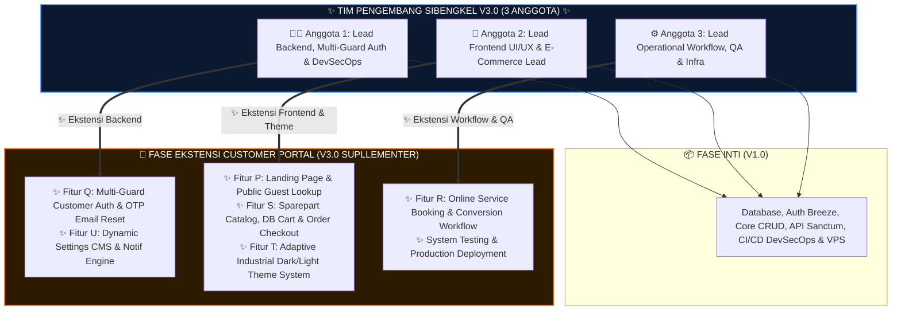
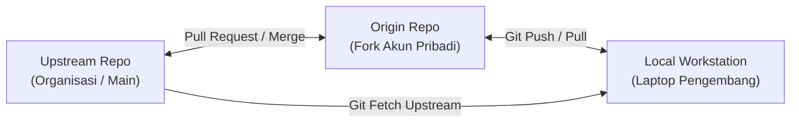

# Guidebook Pelaksanaan & Pengerjaan Sistem Informasi Bengkel (SIBENGKEL)
## Panduan Langkah-demi-Langkah: Dari Setup Lingkungan Lokal hingga Production Deployment & DevSecOps

| Atribut Dokumen | Keterangan & Spesifikasi |
| :--- | :--- |
| **Nama Proyek** | Sistem Informasi Bengkel Terpadu + Customer Portal (SIBENGKEL / SIB) |
| **Mata Kuliah** | Pemrograman Web + Sistem Basis Data |
| **Jenis Dokumen** | **Master Development Guidebook & Production Playbook** |
| **Versi Dokumen** | **3.0 (End-to-End Execution Guide & SSOT Playbook — Status Aktual V3.0)** |
| **Status Implementation** | **✅ 100% Terimplementasi, Terverifikasi & Live Production Ready** |
| **Target Deadline** | **Senin, 27 Juli 2026** |
| **Portal Pengumpulan PDF** | **[Upload PDF Individual: bit.ly/4gKHyJY](https://bit.ly/4gKHyJY)** |

---

> [!IMPORTANT]
> **Referensi Single Source of Truth (SSOT)**:
> 1. Dokumen Arsitektur Inti: [docs/PRD_Sistem_Informasi_Bengkel.md](file:///Users/ryo/PemrogramanWeb/SIBENGKEL/SIBENGKEL/docs/PRD_Sistem_Informasi_Bengkel.md)
> 2. Dokumen Arsitektur Suplementer (V3.0): [docs/PRD_Suplementer_Customer_Portal_SIBENGKEL.md](file:///Users/ryo/PemrogramanWeb/SIBENGKEL/SIBENGKEL/docs/PRD_Suplementer_Customer_Portal_SIBENGKEL.md)
> 3. Panduan UI Tokens & Design System: [docs/DESIGN.md](file:///Users/ryo/PemrogramanWeb/SIBENGKEL/SIBENGKEL/docs/DESIGN.md)


---

## 📚 Daftar Isi (Table of Contents)

<details open>
<summary><b>Klik untuk Membuka / Menutup Navigasi Bab</b></summary>

- [📌 Rekomendasi Pembagian Peran Tim 3 Orang](#-rekomendasi-pembagian-peran-tim-3-orang-non-mandatory--fleksibel)
- [🗺️ Peta Alur Pengerjaan Sekuensial Fitur (A → O)](#️-peta-alur-pengerjaan-sekuensial-fitur-a--o)
- [🛠️ FASE 1: PERSIAPAN & INFRASTRUKTUR DASAR LOKAL](#-fase-1-persiapan--infrastruktur-dasar-lokal)
  - [Fitur A: Setup Local Environment & Workspace Project](#-fitur-a-setup-local-environment--workspace-project)
    - [1.1. Panduan Download & Instalasi Perangkat Lunak](#11-panduan-download--instalasi-perangkat-lunak-what-to-download-first)
    - [1.2. Alur Urutan Persiapan Lokal Tanpa Celah Logika](#12-alur-urutan-persiapan-lokal-tanpa-celah-logika-step-by-step-order-of-execution)
    - [1.3. Konfigurasi Berkas `.env` Lokal](#13-konfigurasi-berkas-env-lokal)
    - [1.4. Panduan Git Remote & Workflow Kolaborasi Tim 3 Orang](#14-panduan-git-remote--workflow-kolaborasi-tim-3-orang)
  - [Fitur B: Database Architecture, Migrations & Eloquent Data Layer](#-fitur-b-database-architecture-migrations--eloquent-data-layer)
- [🔐 FASE 2: AUTENTIKASI, KEAMANAN & RBAC](#-fase-2-autentikasi-keamanan--rbac)
  - [Fitur C: Authentication Breeze, Sanctum & RBAC Access Control](#-fitur-c-authentication-breeze-sanctum--rbac-access-control)
  - [Fitur C.2: Manajemen Akun Admin & Penutupan Registrasi Publik](#-fitur-c2-manajemen-akun-admin--penutupan-registrasi-publik)
- [👥 FASE 3: MANAJEMEN DATA MASTER (CORE CRUD)](#-fase-3-manajemen-data-master-core-crud)
  - [Fitur D: Data Master Pelanggan (Customers CRUD)](#-fitur-d-data-master-pelanggan-customers-crud)
  - [Fitur E: Data Master Kendaraan (Vehicles CRUD)](#-fitur-e-data-master-kendaraan-vehicles-crud)
  - [Fitur F: Data Master Mekanik (Mechanics CRUD)](#-fitur-f-data-master-mekanik-mechanics-crud)
- [📋 FASE 4: INTI OPERASIONAL & ANALITIK](#-fase-4-inti-operasional--analitik)
  - [Fitur G: Transaksi Servis & Tracking Status Pengerjaan](#-fitur-g-transaksi-servis--tracking-status-pengerjaan)
  - [Fitur H: Dashboard Executive & Analytics Widget](#-fitur-h-dashboard-executive--analytics-widget)
- [🔗 FASE 5: INTEGRASI & RESTFUL API](#-fase-5-integrasi--restful-api)
  - [Fitur I: RESTful API Sanctum Endpoints & Postman Test](#-fitur-i-restful-api-sanctum-endpoints--postman-test)
- [🎨 FASE 6: FRONTEND MOBILE-FIRST TAILWIND CSS](#-fase-6-frontend-mobile-first-tailwind-css)
  - [Fitur J: Mobile-First Responsive UI/UX dengan Tailwind CSS](#-fitur-j-mobile-first-responsive-uiux-dengan-tailwind-css)
- [🚀 FASE EKSTENSI: CUSTOMER PORTAL & MODERN PLATFORM](#-fase-ekstensi-ekosistem-customer-portal--modern-platform)
  - [Fitur P: Public Guest Lookup & Dynamic Landing Page](#-fitur-p-public-guest-lookup--dynamic-landing-page)
  - [Fitur Q: Multi-Guard Auth Customer & Hybrid Account Management](#-fitur-q-multi-guard-auth-customer--hybrid-account-management)
  - [Fitur R: Booking Servis Daring & Conversion Flow oleh Admin](#-fitur-r-booking-servis-daring--conversion-flow-oleh-admin)
  - [Fitur S: E-Commerce Sparepart Catalog, Persistent Cart & Checkout Order](#-fitur-s-e-commerce-sparepart-catalog-persistent-cart--checkout-order)
  - [Fitur T: System Theme Adaptif Industrial (Dark & Light Mode Toggle)](#-fitur-t-system-theme-adaptif-industrial-dark--light-mode-toggle)
  - [Fitur U: Dynamic System Settings (WA Config), Content CMS & System Notifications](#-fitur-u-dynamic-system-settings-wa-config-content-cms--system-notifications)
- [🛡️ FASE 7: OTOMASI DEVSECOPS & CI/CD PIPELINE](#-fase-7-otomasi-devsecops--cicd-pipeline)
  - [Fitur K: Complete DevSecOps Pipeline GitHub Actions](#-fitur-k-complete-devsecops-pipeline-github-actions)
- [☁️ FASE 8: INFRASTRUKTUR VPS & CLOUDFLARE CUSTOM DOMAIN](#-fase-8-infrastruktur-vps--cloudflare-custom-domain)
  - [Fitur L: VPS Hardening & LEMP Stack Provisioning](#-fitur-l-vps-hardening--lemp-stack-provisioning)
  - [Fitur M: Cloudflare Security, Custom Domain & SSL/TLS Setup](#-fitur-m-cloudflare-security-custom-domain--ssltls-setup)
  - [Fitur N: Staging, Production Deployment Execution & Live Verification](#-fitur-n-staging-production-deployment-execution--live-verification)
- [📑 FASE 9: REKAPITULASI AKADEMIS & SUBMISSION](#-fase-9-rekapitulasi-akademis--submission)
  - [Fitur O: Laporan PDF Akademis BAB I-V & Portal Submission](#-fitur-o-laporan-pdf-akademis-bab-i-v--portal-submission)

</details>

---

## 📌 Rekomendasi Pembagian Peran Tim 3 Orang (*Non-Mandatory / Fleksibel*)

> [!TIP]
> **✨ UPDATE EKSTENSI V3.0 — ALOKASI TUGAS TERINTEGRASI**:
> Pembagian peran tim telah diselaraskan dengan modul Customer Portal, E-Commerce, OTP Email, dan Adaptive Dark/Light Mode Theme System dari dokumen **PRD Suplementer V3.0**.

Dokumen ini disusun agar 3 anggota tim dapat berkolaborasi secara efisien tanpa tumpang tindih (*overlap*) pengerjaan:



* **👨‍💻 Anggota 1 — Lead Backend, Multi-Guard Auth & DevSecOps Engineer**: 
  - **Fase Inti**: Skema database, Eloquent Model, Autentikasi Breeze & Sanctum API, GitHub Actions CI/CD (Trivy, Gitleaks, PHPUnit), dan VPS NGINX.
  - **✨ Ekstensi V3.0**: **Fitur Q** (Multi-Guard Auth Customer, Hybrid Login Email/HP, Reset Password OTP Email via `OtpMail`), **Fitur U** (Dynamic Settings API & System Notifications Engine).
* **🎨 Anggota 2 — Lead Frontend UI/UX & E-Commerce Lead**: 
  - **Fase Inti**: Blade Layouts, Tailwind CSS Mobile-First responsive design, Form CRUD Master Data, dan Dashboard Executive Analytics.
  - **✨ Ekstensi V3.0**: **Fitur P** (Landing Page Dynamic Hero & Public Guest Lookup `/cek-status`), **Fitur S** (Katalog Sparepart, Keranjang DB Persisten `cart_data`, Checkout UI), **Fitur T** (Adaptive Industrial Theme System Dark/Light Mode & CSS Tokens).
* **⚙️ Anggota 3 — Lead Operational Workflow, QA & Cloud Infrastructure**: 
  - **Fase Inti**: Postman API Collection testing, Cetak Invoice PDF, Cloudflare DNS & SSL Full Strict, Verification Live Test, dan Penyusunan Laporan PDF Akademis (BAB I-V).
  - **✨ Ekstensi V3.0**: **Fitur R** (Booking Servis Daring & Alur Konversi Booking ke Transaksi Servis di `/admin/bookings`), Testing E-Commerce & Production Deployment.

---

## 🗺️ Peta Alur Pengerjaan Sekuensial Fitur (A → U)

> [!IMPORTANT]
> **🌟 EFEK SPESIAL — TRANSISI DARI FASE INTI KE FASE EKSTENSI V3.0**:
> Peta alur sekuensial berikut menonjolkan transisi sekuensial dari pengerjaan modul operasional dasar (**Fitur A → J**) menuju ekosistem Customer Portal & Modern Platform (**Fitur P → U**), sebelum melangkah ke otomasi DevSecOps dan Production Deployment (**Fitur K → O**).

```mermaid
flowchart TD
    subgraph FASE_INTI_1 ["📦 FASE INTI (FITUR A → J): INFRASTRUKTUR & CORE OPERATIONAL"]
        FiturA[Fitur A: Setup Environment Local & Workspace] --> FiturB[Fitur B: Database Architecture & Eloquent Layer]
        FiturB --> FiturC[Fitur C: Authentication Breeze, Sanctum & RBAC]
        FiturC --> FiturD[Fitur D: Data Master Pelanggan / Customers CRUD]
        FiturD --> FiturE[Fitur E: Data Master Kendaraan / Vehicles CRUD]
        FiturE --> FiturF[Fitur F: Data Master Mekanik / Mechanics CRUD]
        FiturF --> FiturG[Fitur G: Transaksi Servis & Tracking Status]
        FiturG --> FiturH[Fitur H: Dashboard Admin & Executive Analytics]
        FiturH --> FiturI[Fitur I: RESTful API Sanctum & Postman Test]
        FiturI --> FiturJ[Fitur J: Mobile-First Responsive UI/UX Tailwind]
    end

    subgraph FASE_EKSTENSI ["🌟 FASE EKSTENSI SUPLLEMENTER V3.0 (MODERN ECOSYSTEM) 🌟"]
        FiturP["✨ Fitur P: Public Guest Lookup & Dynamic Landing Page"]
        FiturQ["✨ Fitur Q: Multi-Guard Auth Customer & OTP Email Reset"]
        FiturR["✨ Fitur R: Booking Servis Daring & Conversion Workflow"]
        FiturS["✨ Fitur S: E-Commerce Sparepart Catalog, DB Cart & Orders"]
        FiturT["✨ Fitur T: Adaptive Industrial Theme Dark/Light Mode"]
        FiturU["✨ Fitur U: Dynamic System Settings CMS & Notifications"]
    end

    subgraph FASE_INTI_2 ["🛡️ FASE DEPLOYMENT & AKADEMIS (FITUR K → O)"]
        FiturK[Fitur K: Complete DevSecOps Pipeline GitHub Actions]
        FiturL[Fitur L: VPS Hardening & LEMP Stack Provisioning]
        FiturM[Fitur M: Cloudflare Security, Custom Domain & SSL]
        FiturN[Fitur N: Staging, Production Deployment & Live Test]
        FiturO[Fitur O: Laporan PDF Akademis BAB I-V & Submission]
    end

    FiturJ ==> |"🚀 Transisi ke Customer Portal"| FiturP
    FiturP --> FiturQ
    FiturQ --> FiturR
    FiturR --> FiturS
    FiturS --> FiturT
    FiturT --> FiturU
    FiturU ==> |"🛡️ Lanjut ke DevSecOps & VPS"| FiturK
    FiturK --> FiturL
    FiturL --> FiturM
    FiturM --> FiturN
    FiturN --> FiturO

    style FASE_EKSTENSI fill:#1a1000,stroke:#FF6B00,stroke-width:3px,color:#fff
    style FiturP fill:#2d1500,stroke:#FF6B00,color:#fff
    style FiturQ fill:#2d1500,stroke:#FF6B00,color:#fff
    style FiturR fill:#2d1500,stroke:#FF6B00,color:#fff
    style FiturS fill:#2d1500,stroke:#FF6B00,color:#fff
    style FiturT fill:#2d1500,stroke:#FF6B00,color:#fff
    style FiturU fill:#2d1500,stroke:#FF6B00,color:#fff
```



---

# FASE 1: PERSIAPAN & INFRASTRUKTUR DASAR LOKAL

## 🛠️ Fitur A: Setup Local Environment & Workspace Project

### 1.1. Panduan Download & Instalasi Perangkat Lunak (What to Download First)

Sebelum menjalankan perintah apa pun di terminal, Anda **WAJIB** mengunduh dan menginstal perangkat lunak pendukung berikut sesuai dengan sistem operasi Anda:

#### A. Pilihan Bundle Web Server & Database (Pilih Salah Satu):
1. **Windows (Sangat Direkomendasikan)**:
   - **Laragon Full (PHP 8.x, MySQL, NGINX/Apache, Git, Composer)**: Unduh di [laragon.org/download](https://laragon.org/download/). *Sudah mencakup semua kebutuhan dasar sekali install.*
   - ATAU **XAMPP for Windows (PHP 8.2+)**: Unduh di [apachefriends.org](https://www.apachefriends.org/). *(Mengandung Apache, MariaDB/MySQL, dan phpMyAdmin)*.
2. **macOS**:
   - **Laravel Herd** (Sangat praktis): Unduh di [herd.laravel.com](https://herd.laravel.com/) + **DBngin** (Database GUI MySQL) di [dbngin.com](https://dbngin.com/).
   - ATAU via **Homebrew Terminal**:
     ```bash
     brew install php@8.2 composer node mysql
     brew services start mysql
     ```
3. **Linux (Ubuntu/Debian)**:
   ```bash
   sudo apt update
   sudo apt install -y php8.2 php8.2-mysql php8.2-mbstring php8.2-xml composer nodejs npm mysql-server
   sudo systemctl start mysql
   ```

#### B. Perangkat Lunak Pendukung Wajib (Unduh terpisah jika tidak menggunakan Laragon):
- **Composer**: Dependency Manager PHP — Unduh di [getcomposer.org](https://getcomposer.org/download/)
- **Node.js (v18+) & NPM**: JavaScript Runtime — Unduh di [nodejs.org](https://nodejs.org/)
- **Git**: Version Control System — Unduh di [git-scm.com](https://git-scm.com/)
- **VS Code**: Code Editor Utama — Unduh di [code.visualstudio.com](https://code.visualstudio.com/)
- **Postman**: Aplikasi Pengujian REST API — Unduh di [postman.com/downloads](https://www.postman.com/downloads/)

---

### 1.2. Alur Urutan Persiapan Lokal Tanpa Celah Logika (Step-by-Step Order of Execution)

Pastikan Anda mengikuti **urutan sekuensial** ini secara runtut tanpa ada langkah yang melompati:

#### Langkah 1: Jalankan Database Service MySQL
- **Laragon**: Buka aplikasi Laragon, klik tombol **"Start All"** (Service MySQL & Apache/NGINX otomatis aktif).
- **XAMPP**: Buka XAMPP Control Panel, klik **"Start"** pada modul **MySQL** dan **Apache**.
- **macOS / Linux**: Pastikan service MySQL sudah berjalan (`brew services start mysql` atau `sudo systemctl start mysql`).

#### Langkah 2: Buat Database `sibengkel_db` di Lokal
Pilih salah satu cara pembuatan database sebelum menjalankan migrasi Laravel:
- **Cara A (Via phpMyAdmin GUI)**:
  1. Buka browser, akses `http://localhost/phpmyadmin`
  2. Klik menu **Databases / Basis Data** di sebelah kiri.
  3. Masukkan nama database: `sibengkel_db`, pilih Collation `utf8mb4_unicode_ci`.
  4. Klik tombol **Create / Buat**.
- **Cara B (Via Terminal / MySQL CLI)**:
  * **Cara Masuk ke MySQL CLI**:
    - **XAMPP (Windows)**: Buka XAMPP Control Panel → Klik tombol **"Shell"** di sebelah kanan → Ketik `mysql -u root -p` → Tekan **Enter** (*Password bawaan kosong, langsung tekan Enter*).
    - **Laragon (Windows)**: Buka Laragon → Klik tombol **"Terminal"** di kanan bawah → Ketik `mysql -u root -p` → Tekan **Enter**.
    - **macOS (Homebrew)**: Buka Terminal → Ketik `mysql -u root -p` → Tekan **Enter**.
    - **Linux (Ubuntu)**: Buka Terminal → Ketik `sudo mysql -u root -p` → Masukkan password sudo.
  * **Perintah Membuat Database**:
    ```sql
    CREATE DATABASE sibengkel_db CHARACTER SET utf8mb4 COLLATE utf8mb4_unicode_ci;
    EXIT;
    ```

#### Langkah 3: Inisialisasi Project Laravel & Git
Setelah database lokal siap, buka Terminal / Command Prompt:
```bash
# 1. Masuk ke folder workspace utama Anda
cd /path/to/your/workspace

# 2. Buat Project Laravel 10 baru
composer create-project laravel/laravel SIBENGKEL

# 3. Masuk ke direktori project yang baru dibuat
cd SIBENGKEL

# 4. Inisialisasi Git Lokal
git init
git branch -M main
```

#### Langkah 4: Konfigurasi Berkas `.env` & App Key
Salin `.env.example` menjadi `.env` dan atur kredensial database yang sesuai dengan server lokal Anda:

```env
APP_NAME=SIBENGKEL
APP_ENV=local
APP_KEY=
APP_DEBUG=true
APP_URL=http://localhost:8000

LOG_CHANNEL=stack
LOG_DEPRECATIONS_CHANNEL=null
LOG_LEVEL=debug

DB_CONNECTION=mysql
DB_HOST=127.0.0.1
DB_PORT=3306
DB_DATABASE=sibengkel_db
DB_USERNAME=root
DB_PASSWORD=

SESSION_DRIVER=file
SESSION_LIFETIME=120

SANCTUM_STATEFUL_DOMAINS=localhost,127.0.0.1
```

Generate App Key:
```bash
php artisan key:generate
```

#### Langkah 5: Commit Pertama & Initial Push ke GitHub Remote
Setelah project Laravel terinisialisasi dan file `.env` sudah siap, lakukan *initial commit* dan *push* pertama ke repositori GitHub:

```bash
# 1. Staging seluruh berkas project
git add .

# 2. Buat commit pertama
git commit -m "feat: initial commit project SIBENGKEL"

# 3. Hubungkan ke repositori baru di GitHub (Sesuaikan URL dengan repositori Anda)
git remote add origin https://github.com/USERNAME/SIBENGKEL.git

# 4. Push branch 'main' ke GitHub
git push -u origin main

# 5. Buat dan push branch integrasi 'dev'
git checkout -b dev
git push -u origin dev
```

### 1.4. Panduan Git Remote & Workflow Kolaborasi Tim 3 Orang

Terdapat **dua pilihan model kolaborasi Git** yang dapat digunakan oleh tim Anda. Pilih model yang paling sesuai dengan kebutuhan dan kenyamanan tim:

---

#### ⚖️ Perbandingan Model Kolaborasi: Shared Repo vs. Fork & Upstream

| Aspek | Opsi 1: Shared Repository Model (Direkomendasikan untuk Tim Kecil 3 Orang) | Opsi 2: Fork & Upstream Model (Standar Industri & Open-Source) |
| :--- | :--- | :--- |
| **Konsep Utama** | 1 Repositori Utama bersama. Seluruh anggota diberikan akses *Collaborator / Write*. | 1 Repositori Pusat (**Upstream**). Tiap anggota membuat salinan pribadi di akun GitHub masing-masing (**Fork / Origin**). |
| **Kelebihan** | Lebih sederhana, cepat, perintah terminal lebih sedikit, visibilitas branch tim langsung terlihat. | Isolasi repositori utama 100% aman dari kesalahan commit langsung, standar proyek skala besar. |
| **Kekurangan** | Membutuhkan kedisiplinan agar tidak ada anggota yang melakukan commit/push langsung ke `main`. | Membutuhkan pengelolaan 2 remote (`origin` dan `upstream`) serta langkah sinkronisasi tambahan (`git fetch upstream`). |

---

#### 🅰️ OPSI 1: Shared Repository Model (Direct Feature Branching)

##### 1. Menghubungkan Repositori Lokal ke GitHub Remote
Salah satu anggota (misal: Anggota 1) membuat repositori baru di GitHub (misal: `https://github.com/USERNAME/SIBENGKEL.git`), menambahkan Anggota 2 & 3 sebagai **Collaborator** di GitHub Settings, lalu mendaftarkan remote:

```bash
# Tambahkan remote origin GitHub
git remote add origin https://github.com/USERNAME/SIBENGKEL.git

# Push branch main awal ke GitHub
git push -u origin main

# Buat dan push branch integrasi 'dev'
git checkout -b dev
git push -u origin dev
```

Anggota 2 dan 3 kemudian me-clone repositori yang sama:
```bash
git clone https://github.com/USERNAME/SIBENGKEL.git
cd SIBENGKEL
git checkout dev
```

##### 2. Strategi Branching & Alur Harian
- **`main`**: Branch Rilis Produksi (*Protected branch*).
- **`dev`**: Branch Integrasi Utama.
- **`feature/*`**: Branch fitur anggota (`feature/backend-auth-api`, `feature/frontend-crud-views`, `feature/qa-invoice-docs`).

Perintah Harian:
```bash
# 1. Update lokal dari dev
git checkout dev && git pull origin dev

# 2. Kerja di branch fitur
git checkout feature/nama-fitur
git merge dev

# 3. Commit & Push
git add .
git commit -m "feat(customer): tambah controller data pelanggan"
git push origin feature/nama-fitur

# 4. Buat Pull Request (PR) di GitHub dari feature/nama-fitur -> dev
```

---

#### 🅱️ OPSI 2: Fork & Upstream Model (Forking Workflow)

Model ini sangat disarankan jika Anda ingin menerapkan **DevOps Best Practices** tingkat lanjut dengan pemisahan akses total:



##### 1. Setup Awal Fork & Upstream Remote
1. **Anggota 1 (Repo Owner)**: Membuat repositori pusat di GitHub: `https://github.com/REPOS-PUSAT/SIBENGKEL.git` (**Upstream**).
2. **Anggota 2 & Anggota 3**:
   - Buka halaman `https://github.com/REPOS-PUSAT/SIBENGKEL.git` di browser.
   - Klik tombol **Fork** di pojok kanan atas untuk membuat salinan di akun GitHub pribadi masing-masing (`https://github.com/AKUN-PRIBADI/SIBENGKEL.git`).
   - Clone repositori **Fork milik pribadi** (`origin`) ke laptop:
     ```bash
     git clone https://github.com/AKUN-PRIBADI/SIBENGKEL.git
     cd SIBENGKEL
     ```
   - Daftarkan repositori pusat sebagai **`upstream`**:
     ```bash
     git remote add upstream https://github.com/REPOS-PUSAT/SIBENGKEL.git
     ```
   - Verifikasi remote URL:
     ```bash
     git remote -v
     # origin   -> https://github.com/AKUN-PRIBADI/SIBENGKEL.git (push/fetch)
     # upstream -> https://github.com/REPOS-PUSAT/SIBENGKEL.git (fetch/push)
     ```

##### 2. Alur Kerja Harian Model Fork & Upstream
1. **Sinkronisasi Kode Lokal dengan `upstream/dev`**:
   ```bash
   # Ambil pembaruan terbaru dari repositori pusat
   git fetch upstream
   git checkout dev
   git merge upstream/dev
   ```

2. **Buat Branch Fitur Baru**:
   ```bash
   git checkout -b feature/nama-fitur
   ```

3. **Koding & Commit Perubahan**:
   ```bash
   git add .
   git commit -m "feat(auth): tambah middleware RBAC dan Sanctum API"
   ```

4. **Push ke Repositori Fork Pribadi (`origin`)**:
   ```bash
   git push origin feature/nama-fitur
   ```

5. **Buat Cross-Repository Pull Request (PR)**:
   - Buka GitHub repositori Fork pribadi Anda.
   - Klik tombol **Compare & Pull Request**.
   - Atur target merge:
     - **Base Repository**: `REPOS-PUSAT/SIBENGKEL` (Branch: `dev`)
     - **Head Repository**: `AKUN-PRIBADI/SIBENGKEL` (Branch: `feature/nama-fitur`)
   - Minta pemilik repositori pusat (Anggota 1) mereview dan melakukan **Merge**.

---

#### 🛠️ Penanganan Konflik Kode (Merge Conflict Resolution)
Jika terjadi *merge conflict* saat menggabungkan branch (pada Opsi 1 maupun Opsi 2):

```bash
# 1. Pindah ke branch fitur Anda dan tarik pembaruan dari dev utama
git checkout feature/nama-fitur
git fetch upstream   # (atau 'git fetch origin' jika menggunakan Opsi 1)
git merge upstream/dev

# 2. Buka VS Code, selesaikan penanda konflik (Accept Current / Incoming Change).
# 3. Commit dan push kembali:
git add .
git commit -m "fix(conflict): selesaikan konflik merge dari upstream/dev"
git push origin feature/nama-fitur
```

---

## 🗄️ Fitur B: Database Architecture, Migrations & Eloquent Data Layer

### 2.1. Membuat Migration Files
Jalankan perintah berikut untuk membuat file migrasi entitas utama:

```bash
php artisan make:migration create_customers_table
php artisan make:migration create_vehicles_table
php artisan make:migration create_mechanics_table
php artisan make:migration create_service_transactions_table
```

Isi berkas migrasi di `database/migrations/`:

#### A. Migration `customers` (`create_customers_table.php`)
```php
<?php

use Illuminate\Database\Migrations\Migration;
use Illuminate\Database\Schema\Blueprint;
use Illuminate\Support\Facades\Schema;

return new class extends Migration {
    public function up(): void {
        Schema::create('customers', function (Blueprint $table) {
            $table->id();
            $table->string('name');
            $table->string('phone', 30);
            $table->text('address')->nullable();
            $table->timestamps();
        });
    }

    public function down(): void {
        Schema::dropIfExists('customers');
    }
};
```

#### B. Migration `vehicles` (`create_vehicles_table.php`)
```php
<?php

use Illuminate\Database\Migrations\Migration;
use Illuminate\Database\Schema\Blueprint;
use Illuminate\Support\Facades\Schema;

return new class extends Migration {
    public function up(): void {
        Schema::create('vehicles', function (Blueprint $table) {
            $table->id();
            $table->foreignId('customer_id')->constrained('customers')->onDelete('cascade');
            $table->string('plate_number', 20)->unique();
            $table->string('brand', 100);
            $table->string('model', 100);
            $table->integer('year');
            $table->timestamps();
        });
    }

    public function down(): void {
        Schema::dropIfExists('vehicles');
    }
};
```

#### C. Migration `mechanics` (`create_mechanics_table.php`)
```php
<?php

use Illuminate\Database\Migrations\Migration;
use Illuminate\Database\Schema\Blueprint;
use Illuminate\Support\Facades\Schema;

return new class extends Migration {
    public function up(): void {
        Schema::create('mechanics', function (Blueprint $table) {
            $table->id();
            $table->foreignId('user_id')->constrained('users')->onDelete('cascade');
            $table->string('name');
            $table->string('phone', 30)->nullable();
            $table->string('expertise', 150)->nullable();
            $table->timestamps();
        });
    }

    public function down(): void {
        Schema::dropIfExists('mechanics');
    }
};
```

#### D. Migration `service_transactions` (`create_service_transactions_table.php`)
```php
<?php

use Illuminate\Database\Migrations\Migration;
use Illuminate\Database\Schema\Blueprint;
use Illuminate\Support\Facades\Schema;

return new class extends Migration {
    public function up(): void {
        Schema::create('service_transactions', function (Blueprint $table) {
            $table->id();
            $table->foreignId('vehicle_id')->constrained('vehicles')->onDelete('cascade');
            $table->foreignId('user_id')->nullable()->constrained('users')->onDelete('set null');
            $table->foreignId('mechanic_id')->nullable()->constrained('mechanics')->onDelete('set null');
            $table->enum('type', ['servis', 'penjualan'])->default('servis');
            $table->text('complaint');
            $table->decimal('cost', 12, 2)->default(0.00);
            $table->enum('status', ['pending', 'proses', 'selesai'])->default('pending');
            $table->date('transaction_date');
            $table->timestamps();
        });
    }

    public function down(): void {
        Schema::dropIfExists('service_transactions');
    }
};
```

### 2.2. Menambahkan Kolom Role pada Tabel `users`
Buat migrasi penambahan kolom `role` pada `users`:

```bash
php artisan make:migration add_role_to_users_table --table=users
```

Isikan kode berikut:
```php
public function up(): void {
    Schema::table('users', function (Blueprint $table) {
        $table->string('username')->unique()->after('name');
        $table->enum('role', ['admin', 'mekanik'])->default('mekanik')->after('email');
    });
}

public function down(): void {
    Schema::table('users', function (Blueprint $table) {
        $table->dropColumn(['username', 'role']);
    });
}
```

Jalankan Migration:
```bash
php artisan migrate
```

### 2.3. Definisi Model Eloquent & Relasi (`app/Models/`)

#### Model `Customer.php`
```php
<?php

namespace App\Models;

use Illuminate\Database\Eloquent\Factories\HasFactory;
use Illuminate\Database\Eloquent\Model;

class Customer extends Model {
    use HasFactory;
    protected $fillable = ['name', 'phone', 'address'];

    public function vehicles() {
        return $this->hasMany(Vehicle::class);
    }
}
```

#### Model `Vehicle.php`
```php
<?php

namespace App\Models;

use Illuminate\Database\Eloquent\Factories\HasFactory;
use Illuminate\Database\Eloquent\Model;

class Vehicle extends Model {
    use HasFactory;
    protected $fillable = ['customer_id', 'plate_number', 'brand', 'model', 'year'];

    public function customer() {
        return $this->belongsTo(Customer::class);
    }

    public function transactions() {
        return $this->hasMany(ServiceTransaction::class);
    }
}
```

#### Model `Mechanic.php`
```php
<?php

namespace App\Models;

use Illuminate\Database\Eloquent\Factories\HasFactory;
use Illuminate\Database\Eloquent\Model;

class Mechanic extends Model {
    use HasFactory;
    protected $fillable = ['user_id', 'name', 'phone', 'expertise'];

    public function user() {
        return $this->belongsTo(User::class);
    }

    public function transactions() {
        return $this->hasMany(ServiceTransaction::class);
    }
}
```

#### Model `ServiceTransaction.php`
```php
<?php

namespace App\Models;

use Illuminate\Database\Eloquent\Factories\HasFactory;
use Illuminate\Database\Eloquent\Model;

class ServiceTransaction extends Model {
    use HasFactory;

    protected $fillable = [
        'vehicle_id', 'user_id', 'mechanic_id', 'type',
        'complaint', 'cost', 'status', 'transaction_date'
    ];

    public function vehicle() {
        return $this->belongsTo(Vehicle::class);
    }

    public function user() {
        return $this->belongsTo(User::class);
    }

    public function mechanic() {
        return $this->belongsTo(Mechanic::class);
    }
}
```

### 2.4. Database Seeders untuk Dummy Data Initial (`database/seeders/DatabaseSeeder.php`)
```php
<?php

namespace Database\Seeders;

use Illuminate\Database\Seeder;
use App\Models\User;
use App\Models\Customer;
use App\Models\Vehicle;
use App\Models\Mechanic;
use App\Models\ServiceTransaction;
use Illuminate\Support\Facades\Hash;

class DatabaseSeeder extends Seeder {
    public function run(): void {
        // Admin & Mekanik User Account
        User::create([
            'name' => 'Admin Bengkel',
            'username' => 'adminbengkel',
            'email' => 'admin@sibengkel.com',
            'password' => Hash::make('password123'),
            'role' => 'admin',
        ]);

        $mekanikUser = User::create([
            'name' => 'Mekanik Budi',
            'username' => 'mekanikbengkel',
            'email' => 'mekanik@sibengkel.com',
            'password' => Hash::make('password123'),
            'role' => 'mekanik',
        ]);

        // Dummy Customer & Vehicle
        $customer = Customer::create([
            'name' => 'Budi Santoso',
            'phone' => '081234567890',
            'address' => 'Jl. Merdeka No. 10, Jakarta'
        ]);

        $vehicle = Vehicle::create([
            'customer_id' => $customer->id,
            'plate_number' => 'B 1234 XYZ',
            'brand' => 'Honda',
            'model' => 'Vario 150',
            'year' => 2022
        ]);

        $mechanic = Mechanic::create([
            'user_id' => $mekanikUser->id,
            'name' => 'Mekanik Budi',
            'phone' => '089876543210',
            'expertise' => 'Spesialis Mesin & Injeksi'
        ]);

        ServiceTransaction::create([
            'vehicle_id' => $vehicle->id,
            'user_id' => 1,
            'mechanic_id' => $mechanic->id,
            'type' => 'servis',
            'complaint' => 'Ganti Oli Mesin & Tune Up Rutin',
            'cost' => 350000.00,
            'status' => 'proses',
            'transaction_date' => now()->toDateString()
        ]);
    }
}
```

Eksekusi Seeder:
```bash
php artisan db:seed
```

---

# FASE 2: AUTENTIKASI, KEAMANAN & RBAC

## 🔐 Fitur C: Authentication Breeze, Sanctum & RBAC Access Control

### 3.1. Instalasi Laravel Breeze & Sanctum
Jalankan perintah berikut:

```bash
composer require laravel/breeze laravel/sanctum
php artisan breeze:install blade
npm install
npm run build
```

### 3.2. Membuat Middleware Role Checking (`CheckRole.php`)
Jalankan:
```bash
php artisan make:middleware CheckRole
```

Isikan kode di `app/Http/Middleware/CheckRole.php`:
```php
<?php

namespace App\Http\Middleware;

use Closure;
use Illuminate\Http\Request;
use Symfony\Component\HttpFoundation\Response;

class CheckRole {
    public function handle(Request $request, Closure $next, ...$roles): Response {
        if (!$request->user() || !in_array($request->user()->role, $roles)) {
            abort(403, 'Akses ditolak: Anda tidak memiliki wewenang untuk membuka halaman ini.');
        }
        return $next($request);
    }
}
```

Daftarkan middleware di `app/Http/Kernel.php` atau `bootstrap/app.php` (Laravel 11+):
```php
protected $middlewareAliases = [
    // ...
    'role' => \App\Http\Middleware\CheckRole::class,
];
```

### 3.3. Menonaktifkan Rute Registrasi Publik (`routes/auth.php`)
Sistem SIBENGKEL tidak mengizinkan pendaftaran dari luar. Buka `routes/auth.php` dan berikan komentar pada rute pendaftaran bawaan Breeze:
```php
Route::middleware('guest')->group(function () {
    // Route::get('register', [RegisteredUserController::class, 'create'])->name('register');
    // Route::post('register', [RegisteredUserController::class, 'store']);
    
    // ...
});
```

### 3.4. Membuat Admin Controller (CRUD Admin)
Jalankan perintah:
```bash
php artisan make:controller AdminController --resource
```
Di dalam `AdminController`, buat logika untuk membuat pengguna baru dengan peran mutlak `'admin'`. Jangan lupa memodifikasi *method* `destroy` agar Admin tidak bisa menghapus dirinya sendiri:
```php
if ($admin->id === request()->user()->id) {
    return redirect()->route('admins.index')->with('error', 'Tidak dapat menghapus akun sendiri!');
}
```

---

# FASE 3: MANAJEMEN DATA MASTER (CORE CRUD)

## 👥 Fitur D: Data Master Pelanggan (Customers CRUD)

### 4.1. Controller `CustomerController.php`
Buat Controller:
```bash
php artisan make:controller CustomerController --resource
```

Isikan kode CRUD di `app/Http/Controllers/CustomerController.php`:
```php
<?php

namespace App\Http\Controllers;

use App\Models\Customer;
use Illuminate\Http\Request;

class CustomerController extends Controller {
    public function index(Request $request) {
        $search = $request->query('search');
        $customers = Customer::withCount('vehicles')
            ->when($search, function($query, $search) {
                return $query->where('name', 'like', "%{$search}%")
                             ->orWhere('phone', 'like', "%{$search}%");
            })
            ->latest()
            ->paginate(10);

        return view('customers.index', compact('customers', 'search'));
    }

    public function create() {
        return view('customers.create');
    }

    public function store(Request $request) {
        $validated = $request->validate([
            'name' => 'required|string|max:255',
            'phone' => 'required|string|max:30',
            'address' => 'nullable|string',
        ]);

        Customer::create($validated);
        return redirect()->route('customers.index')->with('success', 'Data Pelanggan berhasil ditambahkan!');
    }

    public function edit(Customer $customer) {
        return view('customers.edit', compact('customer'));
    }

    public function update(Request $request, Customer $customer) {
        $validated = $request->validate([
            'name' => 'required|string|max:255',
            'phone' => 'required|string|max:30',
            'address' => 'nullable|string',
        ]);

        $customer->update($validated);
        return redirect()->route('customers.index')->with('success', 'Data Pelanggan berhasil diperbarui!');
    }

    public function destroy(Customer $customer) {
        $customer->delete();
        return redirect()->route('customers.index')->with('success', 'Data Pelanggan berhasil dihapus!');
    }
}
```

---

## 🚗 Fitur E: Data Master Kendaraan (Vehicles CRUD)

### 5.1. Controller `VehicleController.php`
```bash
php artisan make:controller VehicleController --resource
```

Isi file `app/Http/Controllers/VehicleController.php`:
```php
<?php

namespace App\Http\Controllers;

use App\Models\Vehicle;
use App\Models\Customer;
use Illuminate\Http\Request;

class VehicleController extends Controller {
    public function index(Request $request) {
        $search = $request->query('search');
        $vehicles = Vehicle::with('customer')
            ->when($search, function($q, $search) {
                return $q->where('plate_number', 'like', "%{$search}%")
                         ->orWhere('brand', 'like', "%{$search}%");
            })
            ->latest()
            ->paginate(10);

        return view('vehicles.index', compact('vehicles', 'search'));
    }

    public function create() {
        $customers = Customer::orderBy('name')->get();
        return view('vehicles.create', compact('customers'));
    }

    public function store(Request $request) {
        $validated = $request->validate([
            'customer_id' => 'required|exists:customers,id',
            'plate_number' => 'required|string|unique:vehicles,plate_number|max:20',
            'brand' => 'required|string|max:100',
            'model' => 'required|string|max:100',
            'year' => 'required|integer|min:1900|max:' . (date('Y') + 1),
        ]);

        Vehicle::create($validated);
        return redirect()->route('vehicles.index')->with('success', 'Data Kendaraan berhasil ditambahkan!');
    }

    public function edit(Vehicle $vehicle) {
        $customers = Customer::orderBy('name')->get();
        return view('vehicles.edit', compact('vehicle', 'customers'));
    }

    public function update(Request $request, Vehicle $vehicle) {
        $validated = $request->validate([
            'customer_id' => 'required|exists:customers,id',
            'plate_number' => 'required|string|max:20|unique:vehicles,plate_number,' . $vehicle->id,
            'brand' => 'required|string|max:100',
            'model' => 'required|string|max:100',
            'year' => 'required|integer|min:1900|max:' . (date('Y') + 1),
        ]);

        $vehicle->update($validated);
        return redirect()->route('vehicles.index')->with('success', 'Data Kendaraan berhasil diperbarui!');
    }

    public function destroy(Vehicle $vehicle) {
        $vehicle->delete();
        return redirect()->route('vehicles.index')->with('success', 'Data Kendaraan berhasil dihapus!');
    }
}
```

---

## 🔧 Fitur F: Data Master Mekanik (Mechanics CRUD)

### 6.1. Controller `MechanicController.php`
```bash
php artisan make:controller MechanicController --resource
```

Isi file `app/Http/Controllers/MechanicController.php`:
```php
<?php

namespace App\Http\Controllers;

use App\Models\Mechanic;
use Illuminate\Http\Request;

class MechanicController extends Controller {
    public function index() {
        $mechanics = Mechanic::latest()->paginate(10);
        return view('mechanics.index', compact('mechanics'));
    }

    public function create() {
        return view('mechanics.create');
    }

    public function store(Request $request) {
        $validated = $request->validate([
            'name' => 'required|string|max:255',
            'phone' => 'nullable|string|max:30',
            'expertise' => 'nullable|string|max:150',
        ]);

        Mechanic::create($validated);
        return redirect()->route('mechanics.index')->with('success', 'Data Mekanik berhasil ditambahkan!');
    }

    public function edit(Mechanic $mechanic) {
        return view('mechanics.edit', compact('mechanic'));
    }

    public function update(Request $request, Mechanic $mechanic) {
        $validated = $request->validate([
            'name' => 'required|string|max:255',
            'phone' => 'nullable|string|max:30',
            'expertise' => 'nullable|string|max:150',
        ]);

        $mechanic->update($validated);
        return redirect()->route('mechanics.index')->with('success', 'Data Mekanik berhasil diperbarui!');
    }

    public function destroy(Mechanic $mechanic) {
        $mechanic->delete();
        return redirect()->route('mechanics.index')->with('success', 'Data Mekanik berhasil dihapus!');
    }
}
```

---

# FASE 4: INTI OPERASIONAL & ANALITIK

## 📋 Fitur G: Transaksi Servis & Tracking Status Pengerjaan

### 7.1. Controller `TransactionController.php`
```bash
php artisan make:controller TransactionController
```

Isi `app/Http/Controllers/TransactionController.php`:
```php
<?php

namespace App\Http\Controllers;

use App\Models\ServiceTransaction;
use App\Models\Vehicle;
use App\Models\Mechanic;
use Illuminate\Http\Request;

class TransactionController extends Controller {
    public function index(Request $request) {
        $status = $request->query('status');
        $transactions = ServiceTransaction::with(['vehicle.customer', 'mechanic', 'user'])
            ->when($status, function($q, $status) {
                return $q->where('status', $status);
            })
            ->latest()
            ->paginate(10);

        return view('transactions.index', compact('transactions', 'status'));
    }

    public function create() {
        $vehicles = Vehicle::with('customer')->get();
        $mechanics = Mechanic::all();
        return view('transactions.create', compact('vehicles', 'mechanics'));
    }

    public function store(Request $request) {
        $validated = $request->validate([
            'vehicle_id' => 'required|exists:vehicles,id',
            'mechanic_id' => 'nullable|exists:mechanics,id',
            'type' => 'required|in:servis,penjualan',
            'complaint' => 'required|string',
            'cost' => 'required|numeric|min:0',
            'status' => 'required|in:pending,proses,selesai',
            'transaction_date' => 'required|date',
        ]);

        $validated['user_id'] = auth()->id();

        ServiceTransaction::create($validated);
        return redirect()->route('transactions.index')->with('success', 'Transaksi Servis baru berhasil dicatat!');
    }

    public function updateStatus(Request $request, ServiceTransaction $transaction) {
        $validated = $request->validate([
            'status' => 'required|in:pending,proses,selesai',
        ]);

        $transaction->update(['status' => $validated['status']]);
        return redirect()->back()->with('success', 'Status Pengerjaan Servis berhasil diperbarui!');
    }

    public function printInvoice(ServiceTransaction $transaction) {
        $transaction->load(['vehicle.customer', 'mechanic']);
        return view('transactions.invoice', compact('transaction'));
    }
}
```

---

## 📊 Fitur H: Dashboard Executive & Analytics Widget

### 8.1. Controller `DashboardController.php`
```bash
php artisan make:controller DashboardController
```

Isi `app/Http/Controllers/DashboardController.php`:
```php
<?php

namespace App\Http\Controllers;

use App\Models\Customer;
use App\Models\Vehicle;
use App\Models\ServiceTransaction;

class DashboardController extends Controller {
    public function index() {
        $totalCustomers = Customer::count();
        $totalVehicles = Vehicle::count();
        $activeServices = ServiceTransaction::where('status', 'proses')->count();
        $totalRevenue = ServiceTransaction::where('status', 'selesai')->sum('cost');

        $latestTransactions = ServiceTransaction::with(['vehicle.customer', 'mechanic'])
            ->latest()
            ->take(5)
            ->get();

        return view('dashboard', compact(
            'totalCustomers', 'totalVehicles', 'activeServices', 'totalRevenue', 'latestTransactions'
        ));
    }
}
```

---

# FASE 5: INTEGRASI & RESTFUL API

## 🔗 Fitur I: RESTful API Sanctum Endpoints & Postman Test

### 9.1. Auth API Controller (`AuthApiController.php`)
```bash
php artisan make:controller Api/AuthApiController
```

Isikan kode di `app/Http/Controllers/Api/AuthApiController.php`:
```php
<?php

namespace App\Http\Controllers\Api;

use App\Http\Controllers\Controller;
use Illuminate\Http\Request;
use Illuminate\Support\Facades\Auth;
use App\Models\User;

class AuthApiController extends Controller {
    public function login(Request $request) {
        $credentials = $request->validate([
            'email' => 'required|email',
            'password' => 'required',
        ]);

        if (!Auth::attempt($credentials)) {
            return response()->json([
                'success' => false,
                'message' => 'Email atau password salah.'
            ], 401);
        }

        $user = User::where('email', $request->email)->firstOrFail();
        $token = $user->createToken('auth_token')->plainTextToken;

        return response()->json([
            'success' => true,
            'message' => 'Login API Berhasil',
            'access_token' => $token,
            'token_type' => 'Bearer',
            'user' => [
                'id' => $user->id,
                'name' => $user->name,
                'email' => $user->email,
                'role' => $user->role,
            ]
        ]);
    }

    public function logout(Request $request) {
        $request->user()->currentAccessToken()->delete();
        return response()->json([
            'success' => true,
            'message' => 'Token Sanctum berhasil di-revoke/logout'
        ]);
    }
}
```

### 9.2. Customer & Service API Controllers
Buat controller API untuk data:

```bash
php artisan make:controller Api/CustomerApiController
php artisan make:controller Api/ServiceApiController
```

Isi `CustomerApiController.php`:
```php
<?php

namespace App\Http\Controllers\Api;

use App\Http\Controllers\Controller;
use App\Models\Customer;

class CustomerApiController extends Controller {
    public function index() {
        $customers = Customer::withCount('vehicles')->get();
        return response()->json([
            'success' => true,
            'message' => 'Berhasil mengambil daftar pelanggan',
            'data' => $customers
        ]);
    }
}
```

Isi `ServiceApiController.php`:
```php
<?php

namespace App\Http\Controllers\Api;

use App\Http\Controllers\Controller;
use App\Models\ServiceTransaction;

class ServiceApiController extends Controller {
    public function index() {
        $services = ServiceTransaction::with(['vehicle.customer', 'mechanic'])->get();
        return response()->json([
            'success' => true,
            'message' => 'Berhasil mengambil daftar transaksi servis',
            'data' => $services
        ]);
    }
}
```

### 9.3. Definisi Rute API (`routes/api.php`)
```php
<?php

use Illuminate\Support\Facades\Route;
use App\Http\Controllers\Api\AuthApiController;
use App\Http\Controllers\Api\CustomerApiController;
use App\Http\Controllers\Api\ServiceApiController;

// Public Endpoint
Route::post('/login', [AuthApiController::class, 'login']);

// Authenticated Endpoints (Sanctum Token Protection)
Route::middleware('auth:sanctum')->group(function () {
    Route::post('/logout', [AuthApiController::class, 'logout']);
    Route::get('/customers', [CustomerApiController::class, 'index']);
    Route::get('/services', [ServiceApiController::class, 'index']);
});
```

---

# FASE 6: FRONTEND MOBILE-FIRST TAILWIND CSS

## 🎨 Fitur J: Mobile-First Responsive UI/UX dengan Tailwind CSS

### 10.1. Master Layout Layout Blade (`resources/views/layouts/app.blade.php`)
```html
<!DOCTYPE html>
<html lang="id">
<head>
    <meta charset="UTF-8">
    <meta name="viewport" content="width=device-width, initial-scale=1.0">
    <title>{{ $title ?? 'SIBENGKEL — Sistem Informasi Bengkel' }}</title>
    @vite(['resources/css/app.css', 'resources/js/app.js'])
</head>
<body class="bg-gray-100 font-sans antialiased">
    <div class="min-h-screen flex flex-col md:flex-row">
        <!-- Sidebar Navigation -->
        <aside class="w-full md:w-64 bg-slate-900 text-white flex-shrink-0">
            <div class="p-4 flex items-center justify-between border-b border-slate-800">
                <span class="text-xl font-bold tracking-wider text-blue-400">🔧 SIBENGKEL</span>
            </div>
            <nav class="p-4 space-y-2 text-sm font-medium">
                <a href="{{ route('dashboard') }}" class="block px-4 py-2.5 rounded hover:bg-slate-800 transition">Dashboard</a>
                <a href="{{ route('customers.index') }}" class="block px-4 py-2.5 rounded hover:bg-slate-800 transition">Data Pelanggan</a>
                <a href="{{ route('vehicles.index') }}" class="block px-4 py-2.5 rounded hover:bg-slate-800 transition">Data Kendaraan</a>
                <a href="{{ route('mechanics.index') }}" class="block px-4 py-2.5 rounded hover:bg-slate-800 transition">Data Mekanik</a>
                <a href="{{ route('transactions.index') }}" class="block px-4 py-2.5 rounded hover:bg-slate-800 transition">Transaksi Servis</a>
                
                <form method="POST" action="{{ route('logout') }}" class="pt-4 border-t border-slate-800">
                    @csrf
                    <button type="submit" class="w-full text-left px-4 py-2 rounded text-red-400 hover:bg-slate-800">Logout</button>
                </form>
            </nav>
        </aside>

        <!-- Main Content Area -->
        <main class="flex-1 p-4 md:p-8 overflow-y-auto">
            @if(session('success'))
                <div class="mb-4 p-4 bg-emerald-100 border-l-4 border-emerald-500 text-emerald-700 rounded shadow-sm">
                    {{ session('success') }}
                </div>
            @endif

            {{ $slot }}
        </main>
    </div>
</body>
</html>
```

### 10.2. Contoh Status Badges Responsive di Views Table
```html
@if($transaction->status === 'pending')
    <span class="inline-flex items-center px-2.5 py-0.5 rounded-full text-xs font-semibold bg-amber-100 text-amber-800">
        Pending
    </span>
@elseif($transaction->status === 'proses')
    <span class="inline-flex items-center px-2.5 py-0.5 rounded-full text-xs font-semibold bg-blue-100 text-blue-800">
        Proses Servis
    </span>
@else
    <span class="inline-flex items-center px-2.5 py-0.5 rounded-full text-xs font-semibold bg-emerald-100 text-emerald-800">
        Selesai
    </span>
@endif
```

---

# FASE EKSTENSI: EKOSISTEM CUSTOMER PORTAL & MODERN PLATFORM

> [!NOTE]
> **Modul Suplementer V3.0**: Fase ini melengkapi sistem operasional internal (Admin & Mekanik) dengan menghadirkan antarmuka publik untuk pelanggan, reservasi online, e-commerce sparepart, reset password OTP email, pengaturan sistem dinamis, serta tema adaptif mode gelap/terang.

## 🚀 Fitur P: Public Guest Lookup & Dynamic Landing Page

### P.1. Landing Page Dinamis (`LandingController.php`)
* **Dynamic Hero & Showcase**: Mengambil transaksi servis aktif (`proses`) dan selesai (`selesai`) terbaru dari DB untuk ditampilkan di widget hero publik.
* **Slider Testimoni Hybrid**: Slider ulasan pelanggan otomatis (*infinite loop*) yang mendukung sentuhan/drag serta berhenti otomatis saat *hover*.

### P.2. Pelacakan Status Servis Tanpa Login (`PublicStatusController.php`)
* **Lookup Serbaguna**: Input tunggal cerdas yang menerima Nomor Polisi (`B 5678 AB`) atau Nomor HP (`081234567801`).
* **Visual 3-Stage Timeline**: Progres bar visual (`Pending` → `Sedang Dikerjakan` → `Selesai`).
* **WhatsApp Action Button**: Tombol "Hubungi Bengkel (WhatsApp)" otomatis yang membaca konfigurasi `admin_whatsapp` & `admin_wa_text` dari tabel `settings`.

```bash
# Rute Publik Terkait
GET /               --> LandingController@index (public.landing)
GET /cek-status     --> PublicStatusController@index (public.status.index)
GET /cek-status/cari --> PublicStatusController@search (public.status.search)
```

---

## 🔒 Fitur Q: Multi-Guard Auth Customer & Hybrid Account Management

### Q.1. Multi-Guard Authentication (`config/auth.php`)
Pemisahan entitas akun antara karyawan bengkel (`users` via guard `web`) dan pelanggan (`customers` via guard `customer`).

### Q.2. Hybrid Login & Registration (`CustomerAuthController.php`)
* **Hybrid Login**: Pengguna dapat memasukkan Alamat Email atau Nomor HP dalam satu kolom input (dideteksi otomatis oleh controller via `filter_var($input, FILTER_VALIDATE_EMAIL)`).
* **Reset Password OTP Email (`CustomerForgotPasswordController.php`)**: Mengirimkan kode OTP 6-digit ke email terdaftar via `OtpMail` dengan batasan waktu verifikasi sebelum password dapat diperbarui.

```bash
# Rute Autentikasi Pelanggan
GET  /masuk         --> CustomerAuthController@showLoginForm (public.login)
POST /masuk         --> CustomerAuthController@login (public.login.submit)
GET  /daftar        --> CustomerAuthController@showRegisterForm (public.register)
POST /daftar        --> CustomerAuthController@register (public.register.submit)
POST /lupa-password/send-otp --> CustomerForgotPasswordController@sendOtp (public.forgot_password.send_otp)
```

---

## 📅 Fitur R: Booking Servis Daring & Conversion Flow oleh Admin

### R.1. Reservasi Servis Pelanggan (`BookingPortalController.php`)
Pelanggan terdaftar dapat mendaftarkan jadwal perbaikan kendaraan, menentukan tanggal & jam servis, serta menginput rincian keluhan melalui form di `/booking`.

### R.2. Konversi Booking Menjadi Transaksi Resmi (`AdminBookingController.php`)
Staf Admin meninjau reservasi di `/admin/bookings` dan dapat menekan tombol **"Proses Booking"** (`POST /admin/bookings/{id}/convert`). Sistem secara otomatis:
1. Membuat baris transaksi baru di `service_transactions`.
2. Menugaskan mekanik dan menentukan perkiraan biaya awal.
3. Mengaitkan `service_transaction_id` pada row `booking` dan mengubah statusnya menjadi `dikonversi`.

---

## 🛒 Fitur S: E-Commerce Sparepart Catalog, Persistent Cart & Checkout Order

### S.1. Manajemen Inventaris & Katalog Sparepart (`SparePartController.php`)
* Admin mengelola katalog suku cadang di `/admin/spareparts` (kategori, harga HET, stok, foto produk).
* Pelanggan menjelajahi katalog publik di `/sparepart` dengan pencarian dan filter kategori.

### S.2. Keranjang Belanja Persisten DB & Checkout (`CartController.php` & `OrderController.php`)
* Keranjang belanja disimpan secara persisten di kolom `customers.cart_data` (JSON).
* Proses *Checkout* membentuk transaksi baru pada tabel `orders` & `order_items`, serta mengurangi stok produk secara otomatis.
* Admin mengelola dan memperbarui status pesanan (`menunggu_pembayaran`, `diproses`, `selesai`, `dibatalkan`) di `/admin/orders`.

---

## 🎨 Fitur T: System Theme Adaptif Industrial (Dark & Light Mode Toggle)

### T.1. Design Tokens & Dynamic CSS Variables (`app.css` & `tailwind.config.js`)
* **Tokens**: Industrial Navy (`#0A192F` / `primary`), Workshop Orange (`#FF6B00` / `secondary`), Surface (`#F8F9FB` light, `#111111` dark).
* **Mode Toggle**: Beralih secara instan via tombol di topbar navbar dengan menyimpan preferensi di `localStorage`.
* **Auto Contrast Buttons**: Tombol utama (`bg-primary`) beradaptasi otomatis menjadi warna putih terang (`#EDEDEC`) pada mode gelap dengan teks gelap (`#111111`) untuk menjaga keterbacaan penuh di area perbengkelan.

---

## ⚙️ Fitur U: Dynamic System Settings (WA Config), Content CMS & System Notifications

### U.1. Centralized System Settings (`SettingController.php`)
Super Admin mengelola konfigurasi kontak WhatsApp bengkel dan template pesan otomatis di `/admin/settings` (`settings` table: `admin_whatsapp`, `admin_wa_text`, `superadmin_wa_text`).

### U.2. Content CMS & Notifications System
* **Content CMS**: Pengelolaan halaman statis (`pages`), form pesan masuk (`contact_messages`), dan ulasan pelanggan (`testimonials`).
* **Database Notifications**: Notifikasi interaktif dropdown navbar topbar untuk Admin dan Customer (`notifications` table dengan UUID PK).

---

# FASE 7: OTOMASI DEVSECOPS & CI/CD PIPELINE

## 🛡️ Fitur K: Complete DevSecOps Pipeline GitHub Actions

Buat berkas `.github/workflows/devsecops-cicd.yml`:

```yaml
name: DevSecOps CI/CD Pipeline SIBENGKEL

on:
  push:
    branches: [ "main", "dev" ]
  pull_request:
    branches: [ "main" ]

jobs:
  security-and-linting:
    name: 🔍 DevSecOps Audit & SAST Scanning
    runs-on: ubuntu-latest
    steps:
      - name: Checkout Code
        uses: actions/checkout@v3

      # 1. Secret Scanning via Gitleaks
      - name: Gitleaks Secret Scan
        uses: gitleaks/gitleaks-action@v2
        env:
          GITHUB_TOKEN: ${{ secrets.GITHUB_TOKEN }}

      # 2. Filesystem & OS Security Scan via Trivy
      - name: Trivy Security Scan
        uses: aquasecurity/trivy-action@master
        with:
          scan-type: 'fs'
          ignore-unfixed: true
          format: 'table'
          severity: 'CRITICAL,HIGH'

      # 3. PHP Setup & Composer Security Audit
      - name: Setup PHP 8.2
        uses: shivammathur/setup-php@v2
        with:
          php-version: '8.2'
          tools: composer

      - name: Composer Audit Security Check
        run: composer audit

  automated-testing:
    name: 🧪 Automated Unit & Feature Testing
    needs: security-and-linting
    runs-on: ubuntu-latest
    steps:
      - uses: actions/checkout@v3

      - name: Setup PHP 8.2
        uses: shivammathur/setup-php@v2
        with:
          php-version: '8.2'
          extensions: mbstring, pdo, pdo_mysql

      - name: Copy .env.testing
        run: php -r "file_exists('.env') || copy('.env.example', '.env');"

      - name: Install Dependencies
        run: composer install -q --no-ansi --no-interaction --no-scripts --no-progress --prefer-dist

      - name: Generate App Key
        run: php artisan key:generate

      - name: Execute Tests (PHPUnit)
        env:
          DB_CONNECTION: sqlite
          DB_DATABASE: ':memory:'
        run: vendor/bin/phpunit

  staging-deployment:
    name: 🚀 Staging CD Deployment to VPS
    needs: automated-testing
    if: github.ref == 'refs/heads/dev'
    runs-on: ubuntu-latest
    steps:
      - name: Execute Remote SSH Deploy Script
        uses: appleboy/ssh-action@master
        with:
          host: ${{ secrets.STAGING_VPS_HOST }}
          username: ${{ secrets.STAGING_VPS_USERNAME }}
          key: ${{ secrets.STAGING_VPS_SSH_KEY }}
          script: |
            cd /var/www/staging-sibengkel
            git pull origin dev
            composer install --no-dev --optimize-autoloader
            php artisan migrate --force
            php artisan config:cache
            php artisan route:cache
            php artisan view:cache
            npm install
            npm run build
            sudo systemctl restart php8.2-fpm

  production-deployment:
    name: 🚀 Production CD Deployment to VPS
    needs: automated-testing
    if: github.ref == 'refs/heads/main'
    runs-on: ubuntu-latest
    steps:
      - name: Execute Remote SSH Deploy Script
        uses: appleboy/ssh-action@master
        with:
          host: ${{ secrets.VPS_HOST }}
          username: ${{ secrets.VPS_USERNAME }}
          key: ${{ secrets.VPS_SSH_KEY }}
          script: |
            cd /var/www/sibengkel
            git pull origin main
            composer install --no-dev --optimize-autoloader
            php artisan migrate --force
            php artisan config:cache
            php artisan route:cache
            php artisan view:cache
            npm install
            npm run build
            sudo systemctl restart php8.2-fpm
```

---

# FASE 8: INFRASTRUKTUR VPS & CLOUDFLARE CUSTOM DOMAIN

## ☁️ Fitur L: VPS Hardening & LEMP Stack Provisioning

### 12.1. SSH Akses & User Setup di VPS Ubuntu 22.04 LTS
Akses SSH ke server VPS:

```bash
ssh root@IP_ADDRESS_VPS
```

Update package & buat user non-root:
```bash
apt update && apt upgrade -y
adduser deployer
usermod -aG sudo deployer
```

### 12.2. Instalasi LEMP Stack (Linux, NGINX, MySQL, PHP 8.2-FPM)
```bash
# Install NGINX & Software Properties
apt install -y nginx software-properties-common curl git unzip

# Add PHP 8.2 PPA & Install PHP
add-apt-repository ppa:ondrej/php -y
apt update
apt install -y php8.2-fpm php8.2-cli php8.2-mysql php8.2-mbstring php8.2-xml php8.2-bcmath php8.2-curl php8.2-zip

# Install MySQL Server
apt install -y mysql-server
mysql_secure_installation
```

### 12.3. Konfigurasi NGINX Virtual Host (`/etc/nginx/sites-available/sibengkel`)
Buat file konfigurasi NGINX:

```nginx
server {
    listen 80;
    server_name sibengkel.com www.sibengkel.com;
    root /var/www/sibengkel/public;

    add_header X-Frame-Options "SAMEORIGIN";
    add_header X-Content-Type-Options "nosniff";

    index index.php;
    charset utf-8;

    location / {
        try_files $uri $uri/ /index.php?$query_string;
    }

    location = /favicon.ico { access_log off; log_not_found off; }
    location = /robots.txt  { access_log off; log_not_found off; }

    error_page 404 /index.php;

    location ~ \.php$ {
        fastcgi_pass unix:/var/run/php/php8.2-fpm.sock;
        fastcgi_param SCRIPT_FILENAME $realpath_root$fastcgi_script_name;
        include fastcgi_params;
    }

    location ~ /\.(?!well-known).* {
        deny all;
    }
}
```

Aktifkan Site NGINX:
```bash
ln -s /etc/nginx/sites-available/sibengkel /etc/nginx/sites-enabled/
nginx -t
systemctl reload nginx
```

---

## 🌐 Fitur M: Cloudflare Security, Custom Domain & SSL/TLS Setup

### 13.1. Konfigurasi DNS di Cloudflare Dashboard
1. Login ke Dashboard [Cloudflare](https://dash.cloudflare.com/).
2. Tambahkan domain custom Anda (misal: `sibengkel.com`).
3. Perbarui **Nameservers** pada penyedia registrar domain Anda (misal: Hostinger, Niagahoster) ke Nameservers Cloudflare.
4. Buka menu **DNS > Records** di Cloudflare dan buat record berikut:
   - **Type A**: Name `@` → IPv4 Address VPS (`IP_ADDRESS_VPS`), Proxy status: **Proxied (Orange Cloud)**.
   - **Type CNAME**: Name `www` → Target `sibengkel.com`, Proxy status: **Proxied**.

### 13.2. Konfigurasi SSL/TLS Cloudflare (Full / Full Strict Mode)
1. Di Cloudflare Dashboard, buka menu **SSL/TLS > Overview**.
2. Ubah mode enkripsi menjadi **Full** atau **Full (Strict)**.
3. Buka **SSL/TLS > Edge Certificates**, aktifkan **Always Use HTTPS** dan **Automatic HTTPS Rewrites**.

---

## 🚀 Fitur N: Staging, Production Deployment Execution & Live Verification

### 14.1. Setup Repositori di Server `/var/www/sibengkel`
```bash
cd /var/www
git clone https://github.com/username/SIBENGKEL.git sibengkel
cd sibengkel
chown -R www-data:www-data /var/www/sibengkel/storage /var/www/sibengkel/bootstrap/cache
chmod -R 775 /var/www/sibengkel/storage /var/www/sibengkel/bootstrap/cache
```

### 14.2. Konfigurasi `.env` Production
```bash
cp .env.example .env
nano .env
```
Isikan nilai produksi:
```env
APP_NAME=SIBENGKEL
APP_ENV=production
APP_DEBUG=false
APP_URL=https://sibengkel.com

DB_CONNECTION=mysql
DB_HOST=127.0.0.1
DB_PORT=3306
DB_DATABASE=sibengkel_prod
DB_USERNAME=sibengkel_user
DB_PASSWORD=SecurePasswordProd123!
```

Jalankan perintah optimasi produksi:
```bash
composer install --no-dev --optimize-autoloader
php artisan key:generate
php artisan migrate --force --seed
php artisan config:cache
php artisan route:cache
php artisan view:cache
npm install && npm run build
```

---

# FASE 9: REKAPITULASI AKADEMIS & SUBMISSION

## 📑 Fitur O: Laporan PDF Akademis BAB I-V & Portal Submission

### 15.1. Pemetaan Struktur Laporan ke Dokumen PRD SSOT
Dokumentasi tertulis laporan Tugas Akhir disusun mengikuti panduan berikut:

| Bab Laporan | Sumber Rujukan Utama PRD SSOT & Guidebook |
| :--- | :--- |
| **BAB I: Pendahuluan** | PRD SSOT Bagian 2 (Latar Belakang, Visi, Tujuan) & Bagian 4 (Ruang Lingkup) |
| **BAB II: Landasan Teori** | PRD SSOT Bagian 11 (Tech Stack: Laravel, MVC, MySQL, Sanctum, Tailwind CSS) |
| **BAB III: Perancangan** | PRD SSOT Bagian 6 (Diagram ERD Visual & Kamus Data) & Bagian 8 (Wireframe) |
| **BAB IV: Pengujian & Live**| Guidebook Fitur K (DevSecOps Test) & Fitur N (Screenshot Web Live & Postman API) |
| **BAB V: Penutup** | Kesimpulan Ketercapaian Fitur & Rekomendasi Future Enhancements |
| **Lampiran** | Screenshot Response Postman API, Link GitHub Repo, Link Live Website |

---

### 🚨 Portal Pengumpulan Berkas PDF Individual (Tugas Akhir)

> [!CAUTION]
> **Instruksi Pengumpulan Akademis**:
> - **Deadline Pengumpulan**: **Senin, 27 Juli 2026**
> - **Format File**: Berkas Laporan Tertulis format **PDF**
> - **Kewajiban**: Setiap anggota kelompok **WAJIB** mengunggah berkas secara individual melalui portal resmi:  
>   👉 **[https://bit.ly/4gKHyJY](https://bit.ly/4gKHyJY)**

---

## 🏆 Kesimpulan Guidebook

Dokumen **Guidebook Pengerjaan SIBENGKEL** ini telah merangkum seluruh instruksi teknis dari langkah awal (*Setup Project*), pengembangan logika bisnis, integrasi REST API, otomasisasi **DevSecOps Pipeline CI/CD** (Trivy, Gitleaks, PHPUnit), hingga deployment di server **VPS & Cloudflare SSL**, serta panduan laporan akhir akademis. Berpedomanlah pada panduan ini untuk memastikan suksesnya eksekusi Tugas Akhir Anda!
