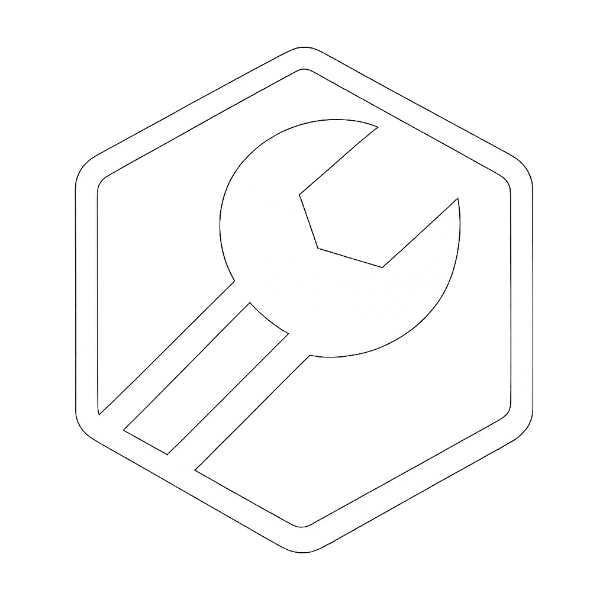

<div align="center">

  
  
  # 🔧 SIBENGKEL
  ### Sistem Informasi Bengkel Terpadu

  **Platform Web Integrated Operations, Online Booking, Sparepart E-Commerce & Customer Portal**

  [](https://laravel.com)
  [](https://php.net)
  [](https://mysql.com)
  [](https://tailwindcss.com)
  [](https://laravel.com/docs/sanctum)
  [](https://github.com)
  [](LICENSE)

  [**Quick Start**](#-quick-start-local-setup) • [**Documentation**](#-documentation-index-single-source-of-truth) • [**API Contract**](#-restful-api-endpoints) • [**Testing Suite**](#-qa--blackbox-testing)

</div>

---

## 📌 About SIBENGKEL

**Sistem Informasi Bengkel (SIBENGKEL)** adalah platform web terpadu tingkat enterprise yang dirancang untuk mendigitalisasi seluruh alur operasional bengkel otomotif serta meningkatkan pengalaman servis pelanggan. Dibangun menggunakan **Laravel 12**, **Eloquent ORM**, dan antarmuka modern **Mobile-First Responsive Design**, SIBENGKEL menghubungkan tim internal bengkel (Admin & Mekanik) dengan pemilik kendaraan secara terpusat.

### 🌟 Keunggulan & Nilai Utama
- ⚡ **Digitalisasi Operasional Bengkel**: Pelacakan status pengerjaan servis real-time (`pending` ➔ `proses` ➔ `selesai`) lengkap dengan penugasan mekanik dan pencetakan nota/invoice PDF.
- 🚗 **Manajemen Pelanggan & Kendaraan**: Pencatatan terpusat yang menghubungkan pemilik dengan kendaraan terdaftar, dilengkapi validasi unik nomor polisi.
- 📅 **Booking Servis Daring**: Pelanggan dapat mengajukan jadwal servis secara online, yang dapat disetujui admin dan langsung dikonversi menjadi transaksi servis aktif.
- 🛒 **E-Commerce Sparepart**: Toko online terintegrasi dengan keranjang belanja persisten (`cart_data`), manajemen stok produk, dan checkout pesanan online.
- 🔍 **Cek Status Servis Publik (`/cek-status`)**: Pelanggan dapat memantau progres perbaikan kendaraan secara real-time hanya dengan nomor polisi tanpa perlu login.
- 🔒 **Dual-Guard Authentication & RBAC**: Autentikasi terpisah (`web` untuk Staff Internal, `customer` untuk Pelanggan Portal) serta Role-Based Access Control 3 level.
- 🛡️ **DevSecOps Ready**: Pipeline CI/CD otomatis via GitHub Actions mencakup linting, static analysis, unit testing, audit keamanan dependensi, dan otomatisasi deployment SSH.

---

## 🛠️ Technology Stack

| Layer | Teknologi | Deskripsi |
|:---|:---|:---|
| **Framework** | **Laravel 12.x** | PHP Web Framework dengan Arsitektur MVC |
| **Bahasa** | **PHP 8.2+** / **JavaScript (ES6+)** | Logika Backend & Interaktivitas Frontend |
| **Database** | **MySQL 8.0 / MariaDB** | Basis Data Relasional (InnoDB, Foreign Key & Indexing) |
| **ORM** | **Eloquent ORM** | 100% Prepared Statements (Zero Raw SQL Injection Risk) |
| **Frontend Styling** | **Tailwind CSS 3.x** | Custom Design System (Monochrome Industrial & Workshop Orange `#FF6B00`) |
| **Interaktivitas** | **Alpine.js** & **Vanilla JS** | Dynamic UI, Toast Notification, Dark Mode Toggle, RAF Marquee |
| **Autentikasi** | **Laravel Breeze** & **Sanctum** | Session-based web auth & Bearer Token API auth |
| **API** | **RESTful API** | Respon standar berformat JSON untuk konsumsi data eksternal |
| **Theme System** | **View Transition API** | Industrial Dark/Light mode dengan animasi circle-reveal premium |
| **DevSecOps** | **GitHub Actions** | Otomasi CI/CD Pipeline (Lint, Test, Audit, SSH Deploy) |
| **Web Server** | **LEMP Stack (Nginx + PHP-FPM)** | Infrastruktur server produksi |

---

## ✨ Fitur Unggulan

### 👨‍💼 Panel Staff Internal (Admin & Mekanik)
- **Executive Analytics Dashboard**: Widget KPI real-time (Total Pelanggan, Kendaraan, Servis Aktif, Chart Tren Pendapatan).
- **Manajemen Transaksi Servis**: Input dan pantau perbaikan kendaraan, penugasan mekanik, estimasi biaya, dan cetak invoice PDF.
- **Database Pelanggan & Kendaraan**: Full CRUD dengan fitur pencarian real-time, filter merek, dan upload foto profil.
- **Manajemen Mekanik**: Kelola profil mekanik, nomor kontak, dan spesialisasi teknis (mesin, kelistrikan, dll).
- **Workflow Booking Servis**: Persetujuan booking masuk dalam satu klik, otomatis membuat `ServiceTransaction` dan mengirim notifikasi in-app ke pelanggan.
- **Kontrol Inventaris Sparepart**: Kelola katalog produk, stok barang, harga eceran (HET), dan pemrosesan pesanan online.

### 👤 Customer Portal & Portal Publik
- **Dynamic Landing Page**: Hero section modern, counter statistik animasi, testimoni auto-scroll infinite dengan efek edge fade mask.
- **Cek Status Servis Publik (`/cek-status`)**: Pelacakan status pengerjaan servis berdasarkan nomor polisi/HP dengan AJAX polling real-time.
- **Sistem Booking Daring**: Pengajuan jadwal servis online dengan pilihan tanggal, waktu, dan rincian keluhan.
- **Toko Sparepart Online**: Jelajahi katalog sparepart, tambah ke keranjang persisten, dan checkout pesanan.
- **Notification Center**: Notifikasi in-app otomatis saat status booking diperbarui, dengan tautan langsung ke halaman status.
- **Adaptive Dark/Light Mode**: Toggle tema adaptif yang tersimpan di `localStorage` tanpa flash of white.

---

## ⚡ Quick Start (Local Setup)

Jalankan SIBENGKEL di lingkungan lokal dalam 5 menit:

### Prasyarat System
- **PHP** >= 8.2 (Ekstensi: `pdo`, `mbstring`, `openssl`, `gd`, `bcmath`)
- **Composer** >= 2.x
- **Node.js** >= 18.x & **npm**
- **MySQL** >= 8.0 atau MariaDB >= 10.4

### Langkah Instalasi

```bash
# 1. Clone repositori
git clone https://github.com/radityobw/SIBENGKEL.git
cd SIBENGKEL

# 2. Install dependensi PHP
composer install

# 3. Install dependensi Node.js
npm install

# 4. Salin file environment & generate application key
cp .env.example .env
php artisan key:generate

# 5. Konfigurasi database di .env
DB_CONNECTION=mysql
DB_HOST=127.0.0.1
DB_PORT=3306
DB_DATABASE=sibengkel
DB_USERNAME=root
DB_PASSWORD=

# 6. Jalankan migrasi database & seeder data awal
php artisan migrate --seed

# 7. Buat symbolic link untuk media upload
php artisan storage:link

# 8. Build aset frontend
npm run build

# 9. Jalankan server lokal
php artisan serve
```

Akses aplikasi melalui peramban web di `http://127.0.0.1:8000`.

---

## 🔑 Kredensial Akun Pengujian (Default)

Setelah menjalankan `php artisan db:seed`, gunakan akun berikut untuk pengujian lokal:

| Peran (Role) | URL Akses | Username / Email | Password | Hak Akses |
|:---|:---|:---|:---|:---|
| **Admin** | `/login` | `admin` *(atau `admin@sibengkel.web.id`)* | `password` | Akses Penuh & Full CRUD |
| **Mekanik** | `/login` | `mechanic` *(atau `mechanic@sibengkel.web.id`)* | `password` | Transaksi Servis & Update Status |
| **Pelanggan** | `/portal/masuk` | `budi@example.com` | `password` | Portal Pelanggan, Booking & Belanja |

---

## 🌐 Endpoints RESTful API

SIBENGKEL menyediakan REST API yang diamankan menggunakan **Laravel Sanctum** (Bearer Token):

| No | Method | Endpoint | Auth | Deskripsi |
|:--:|:---:|:---|:---:|:---|
| 1 | `POST` | `/api/login` | Public | Autentikasi pengguna & terbitkan Sanctum Bearer Token |
| 2 | `POST` | `/api/logout` | Bearer | Revoke token Sanctum aktif |
| 3 | `GET` | `/api/customers` | Bearer | Mengambil seluruh daftar pelanggan |
| 4 | `POST` | `/api/customers` | Bearer | Menambah data pelanggan baru |
| 5 | `GET` | `/api/vehicles` | Bearer | Mengambil daftar kendaraan terdaftar |
| 6 | `POST` | `/api/vehicles` | Bearer | Menambah kendaraan baru |
| 7 | `GET` | `/api/services` | Bearer | Mengambil seluruh daftar transaksi servis |
| 8 | `POST` | `/api/services` | Bearer | Mencatat transaksi servis baru |
| 9 | `PATCH` | `/api/services/{id}/status` | Bearer | Update status pengerjaan servis (`pending`/`proses`/`selesai`) |
| 10 | `GET` | `/api/transactions/{id}/status` | Public | Polling status real-time untuk pelacakan servis publik |

---

## 🧪 QA & Blackbox Testing

SIBENGKEL telah melewati pengujian **Blackbox Testing** komprehensif mencakup **18 modul fungsional** dan **137 test cases** terverifikasi.

```bash
# Jalankan pengujian otomatis PHPUnit / Pest
php artisan test
```

- 📄 **Dokumen Hasil Pengujian**: [`docs/blackbox.md`](docs/blackbox.md) (137 Test Cases `✅ Pass`)
- 📋 **Template Pengujian**: [`docs/blackbox-template.md`](docs/blackbox-template.md)

---

## 📖 Indeks Dokumentasi (Single Source of Truth)

Dokumen teknis, arsitektur, dan panduan presentasi tersedia di folder `docs/`:

| No | Dokumen | Path | Deskripsi |
|:--:|:---|:---|:---|
| 1 | **PRD Utama (SSOT)** | [`docs/PRD_Sistem_Informasi_Bengkel.md`](docs/PRD_Sistem_Informasi_Bengkel.md) | Single Source of Truth untuk ERD, RBAC & API Contract |
| 2 | **PRD Suplementer** | [`docs/PRD_Suplementer_Customer_Portal_SIBENGKEL.md`](docs/PRD_Suplementer_Customer_Portal_SIBENGKEL.md) | PRD Customer Portal, Booking Daring & E-Commerce |
| 3 | **Design System** | [`docs/DESIGN.md`](docs/DESIGN.md) | Tokens warna, tipografi Sora/Inter & komponen UI |
| 4 | **Panduan Presentasi** | [`docs/penjelasan.md`](docs/penjelasan.md) | Penjelasan teknis komprehensif untuk sidang/presentasi |
| 5 | **Blackbox Test Suite**| [`docs/blackbox.md`](docs/blackbox.md) | 137 test cases terverifikasi di 18 modul |
| 6 | **Execution Playbook**| [`docs/guidebook.md`](docs/guidebook.md) | Guidebook pelaksanaan & pengerjaan 1.700+ baris |

---

## 📁 Struktur Direktori Proyek

```
SIBENGKEL/
├── app/
│   ├── Http/
│   │   ├── Controllers/       # Controller Web, Admin, dan API
│   │   └── Middleware/        # Middleware RBAC & Auth Guard
│   ├── Models/                # Eloquent Models & Relasi Database
│   └── Notifications/         # Engine Notifikasi Sistem
├── config/                    # Konfigurasi Aplikasi & Custom Guard
├── database/
│   ├── migrations/            # 26 File Migrasi Terstruktur
│   └── seeders/               # Data Awal & Default Seeder
├── docs/                      # PRD, Architecture & Dokumentasi QA
├── public/                    # Public Assets & Logo Resmi (logobengkel.png)
├── resources/
│   ├── css/                   # Tailwind CSS Styles & Custom Tokens
│   ├── js/                    # Alpine.js & Theme View Transitions
│   └── views/                 # Template Blade (Admin, Customer, Public)
└── routes/
    ├── api.php                # Rute RESTful API (Sanctum)
    ├── auth.php               # Rute Autentikasi Portal
    └── web.php                # Rute Navigasi Web Utama
```

---

## 🛡️ DevSecOps & Deployment

SIBENGKEL dilengkapi dengan pipeline **DevSecOps CI/CD** otomatis (`.github/workflows/devsecops-cicd.yml`):

```
Git Push ➔ Code Linting ➔ Static Analysis ➔ Automated Tests ➔ Security Audit ➔ SSH Production Deploy
```

- **Stack Production**: LEMP (Linux Ubuntu + Nginx + MySQL + PHP 8.2-FPM)
- **Keamanan**: Cloudflare SSL/TLS Full Strict, WAF, CSRF Protection, XSS auto-escaping, Bcrypt Password Hashing.

---

## 👥 Tim Pengembang

Disusun untuk Mata Kuliah **Pemrograman Web & Sistem Basis Data** (Juli 2026):

- **Radityo B. W.** — *Lead Developer & Software Architect* ([@radityobw](https://github.com/radityobw))  
  *Fullstack Architecture, Multi-Guard Auth, REST API Sanctum, DevSecOps & Deployment*
- **Zayyan F. R.** — *Frontend & UI/UX Engineer*  
  *Blade Templating, Mobile-First Design, Dark Mode System, Component Styling & Animations*
- **Raditya A. P.** — *Backend & Database Engineer*  
  *Eloquent Data Layer, Database Migrations, Input Validation & System Testing*

---

<div align="center">

  **SIBENGKEL** • Built with ❤️ using [Laravel](https://laravel.com) and [Tailwind CSS](https://tailwindcss.com)  
  *© 2026 SIBENGKEL Team. All rights reserved.*

</div>
