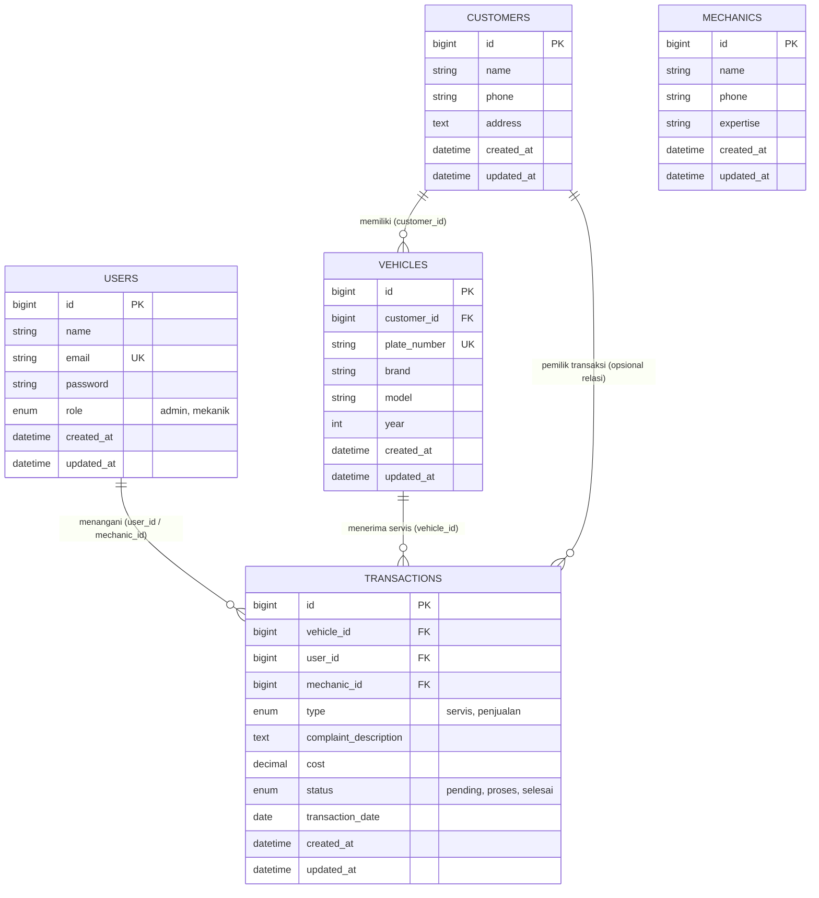
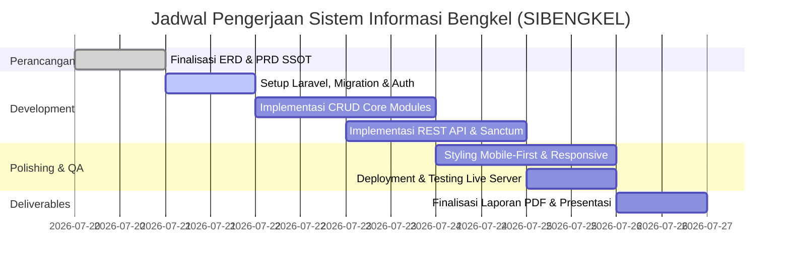

# Product Requirements Document (PRD)
# Single Source of Truth (SSOT) — Sistem Informasi Bengkel (SIBENGKEL / SIB)

| Atribut Dokumen | Keterangan & Spesifikasi |
| :--- | :--- |
| **Nama Proyek** | Sistem Informasi Bengkel Terpadu (SIBENGKEL / SIB) |
| **Mata Kuliah** | Pemrograman Web + Sistem Basis Data |
| **Jenis Dokumen** | **Single Source of Truth (SSOT) Product Requirements Document** |
| **Versi Dokumen** | 1.0 (Final SSOT — Consolidated) |
| **Status Dokumen** | **Disetujui & Siap Diimplementasikan** |
| **Tanggal Terbit** | Juli 2026 |
| **Tenggat Presentasi** | **Senin, 27 Juli 2026** |
| **Ukuran Tim Proyek** | 3 Orang / Kelompok |
| **Portal Pengumpulan** | **[Upload PDF Individual: bit.ly/4gKHyJY](https://bit.ly/4gKHyJY)** |

---

> [!IMPORTANT]
> **Tujuan Dokumen SSOT**: Dokumen ini merupakan acuan tunggal (*Single Source of Truth*) bagi seluruh anggota tim pengembang, dosen penguji, dan stakeholder. Seluruh keputusan arsitektur, skema database, antarmuka pengguna, kontrak API, rencana pengujian, hingga pemetaan laporan akhir wajib merujuk pada dokumen ini.

---

## 1. Ringkasan Eksekutif (Executive Summary)

**Sistem Informasi Bengkel (SIBENGKEL)** adalah platform berbasis web modern, terintegrasi, dan intuitif yang dirancang untuk mendigitalisasi dan mengotomatisasi seluruh alur operasional bengkel otomotif. Menggantikan sistem administrasi manual berbasis kertas/spreadsheet, SIBENGKEL memfasilitasi manajemen data pelanggan, pendaftaran dan riwayat kendaraan, penjadwalan serta penugasan mekanik, dan pelacakan transaksi servis maupun penjualan sparepart secara terstruktur dan terpusat.

Sistem dibangun menggunakan kerangka kerja **Laravel** berbasis arsitektur **Model-View-Controller (MVC)**, basis data relasional **MySQL/MariaDB** dengan **Eloquent ORM**, antarmuka **Mobile-First Responsive Design**, serta layanan **RESTful API** yang diamankan dengan **Laravel Sanctum**. Dokumen ini secara menyeluruh menghubungkan kebutuhan teknis industri dengan standar penilaian akademik Tugas Akhir Pemrograman Web dan Sistem Basis Data.

---

## 2. Visi, Latar Belakang & Tujuan Proyek

### 2.1. Visi Produk
> *"Membangun platform sistem informasi bengkel otomotif terpadu yang modern, efisien, responsif, berkelanjutan, dan aman untuk meningkatkan produktivitas operasional serta menghadirkan pengalaman servis terbaik bagi pelanggan."*

### 2.2. Latar Belakang Permasalahan
Bengkel kendaraan skala kecil hingga menengah mayoritas masih bergantung pada pencatatan manual atau spreadsheet yang terfragmentasi. Kondisi ini menimbulkan berbagai masalah kritis:
1. **Integritas & Pelacakan Data Lemah**: Riwayat servis kendaraan sulit ditelusuri kembali saat pelanggan datang kembali.
2. **Duplikasi & Kerentanan Data**: Data pelanggan dan spesifikasi kendaraan rawan hilang, ganda, atau tidak konsisten.
3. **Ketiadaan Kontrol Akses (RBAC)**: Tidak ada pemisahan wewenang antara pengelola bengkel (admin) dan teknis lapangan (mekanik).
4. **Keterbatasan Integrasi Pihak Ketiga**: Data operasional tidak dapat diakses secara terprogram (API) untuk kebutuhan aplikasi mobile, analitik eksternal, atau integrasi masa depan.
5. **Administrasi Lambat & Rawan Human Error**: Rekapitulasi transaksi dan laporan keuangan harian memakan waktu lama.

### 2.3. Tujuan Utama Proyek
* **Digitalisasi Operasional**: Menyediakan sistem terpusat untuk mengelola master data (admin/mekanik, pelanggan, kendaraan) dan transaksi servis/penjualan.
* **Keamanan & Otorisasi**: Menerapkan autentikasi terproteksi dan otorisasi berbasis peran (*Role-Based Access Control*).
* **Integrasi API Standar Industri**: Menyediakan REST API teramankan token (Laravel Sanctum) untuk konsumsi data eksternal secara aman.
* **Pengalaman Pengguna Responsif**: Menghadirkan antarmuka berbasis *mobile-first design* agar optimal diakses via smartphone, tablet, maupun desktop.
* **Keunggulan Akademis & Standar Kode**: Menerapkan arsitektur MVC, Eloquent ORM, relasi tabel presisi, validasi input ketat, serta pengujian terarah.
* **Deployment Publik**: Menghasilkan aplikasi yang di-deploy secara *live* pada hosting publik dengan domain aktif dan *version control* GitHub.

---

## 3. Stakeholder & User Personas

### 3.1. Stakeholder Utama
* **Internal**: Owner/Admin Bengkel, Mekanik/Teknisi, Tim Pengembang (3 Mahasiswa), Dosen Pembimbing/Penguji.
* **Eksternal**: Pelanggan Bengkel Otomotif.

### 3.2. User Personas

#### A. Admin Bengkel (Pemilik / Pengelola)
* **Tujuan**: Memantau operasional bengkel secara menyeluruh, mengelola pengguna, dan melihat rekapitulasi transaksi.
* **Kebutuhan**: Dashboard intuitif, manajemen data master lengkap (pengguna, pelanggan, kendaraan, transaksi), laporan transaksi.
* **Pain Point**: Sulit merekap pendapatan harian/bulanan dan memantau status pengerjaan servis mekanik.

#### B. Mekanik / Teknisi Bengkel
* **Tujuan**: Mencatat hasil diagnosa servis, memperbarui status pengerjaan, dan mencetak rincian biaya layanan.
* **Kebutuhan**: Antarmuka mobile yang cepat untuk memilih kendaraan, menginput keluhan/perbaikan, dan mengupdate status (`pending` → `proses` → `selesai`).
* **Pain Point**: Formulir kertas manual sering basah/rusak di area bengkel dan pencatatan biaya tidak transparan.

#### C. Pelanggan Bengkel (Pemilik Kendaraan)
* **Tujuan**: Mendapatkan transparansi pengerjaan servis dan riwayat perawatan kendaraan yang terdokumentasi rapi.
* **Kebutuhan**: Estimasi biaya yang jelas dan kepastian riwayat perbaikan kendaraannya tersimpan aman.
* **Pain Point**: Tidak tahu riwayat penggantian sparepart kendaraan pada servis-servis sebelumnya.

---

## 4. Ruang Lingkup Sistem (System Scope)

### 4.1. In-Scope (Dalam Ruang Lingkup Utama)
* **Modul Autentikasi & Otorisasi**: Login, logout, manajemen sesi, proteksi middleware berbasis role (Admin/Mekanik).
* **Modul Data Master**:
  * Management Pengguna (Admin & Mekanik).
  * Management Data Pelanggan (CRUD + pencarian).
  * Management Data Kendaraan (CRUD + relasi ke pelanggan).
* **Modul Transaksi & Riwayat Servis**: Pencatatan transaksi servis/penjualan, pembaruan status pengerjaan, dan filter riwayat.
* **Layanan RESTful API**: API publik terautentikasi Sanctum (`GET /api/services`, `GET /api/customers`, dsb.) berformat JSON.
* **Desain UI/UX Mobile-First**: Layout responsif diuji pada breakpoint 375px (Mobile), 768px (Tablet), dan 1024px+ (Desktop).
* **Deployment & Repository**: Host publik dengan domain aktif dan repositori GitHub yang rapi.
* **Dokumentasi Akademis**: Laporan lengkap Tugas Akhir (BAB I s.d. BAB V + Lampiran).

### 4.2. Out-of-Scope (Di Luar Ruang Lingkup Utama)
* Payment Gateway online otomatis (Midtrans/Xendit) — *(opsional sebagai nilai tambah)*.
* Aplikasi Mobile Native (Android APK / iOS IPA) — *(API disiapkan untuk pengembangan ini)*.
* Notifikasi Real-time SMS/WhatsApp Gateway otomatis — *(direkomendasikan pada Future Enhancement)*.
* Multi-tenant / Multi-cabang bengkel.

---

## 5. Target Pengguna & Matriks Hak Akses (RBAC)

| Modul / Fitur | Hak Akses Admin | Hak Akses Mekanik | Pelanggan *(Entitas Data)* |
| :--- | :---: | :---: | :---: |
| **Login / Logout Sistem** |  Ya |  Ya | ❌ Tidak (opsional portal) |
| **Kelola Pengguna / Mekanik** |  Full CRUD | ❌ No Access | ❌ No Access |
| **Kelola Data Pelanggan** |  Full CRUD |  View & Create | ❌ Read Only (via laporan) |
| **Kelola Data Kendaraan** |  Full CRUD |  Full CRUD | ❌ Read Only (via laporan) |
| **Kelola Transaksi Servis** |  Full CRUD |  Create & Update Status | ❌ Read Only |
| **Lihat Dashboard & Laporan** |  Full Analytics |  Ringkas / Tugas Hari Ini | ❌ No Access |
| **Akses REST API (Sanctum Token)** |  Full Token Access |  Limited Token Access | ❌ Public Endpoint Only |

---

## 6. Arsitektur Data & Desain Basis Data

Sistem mengimplementasikan basis data relasional dengan 4 entitas utama (ditambah tabel pembantu mekanik jika dipisahkan). Seluruh tabel terhubung secara eksplisit menggunakan *Foreign Key constraints* dan *Cascading Rules*.

### 6.1. Entity Relationship Diagram (ERD Visual)



---

### 6.2. Kamus Data (Data Dictionary) Terperinci

#### 1. Tabel: `users`
Memuat akun kredensial pengguna internal (Admin & Mekanik).
| Nama Kolom | Tipe Data | Atribut / Constraint | Keterangan |
| :--- | :--- | :--- | :--- |
| `id` | `bigint` | Primary Key, Auto Increment | Identitas unik pengguna |
| `name` | `varchar(255)` | Not Null | Nama lengkap pengguna |
| `email` | `varchar(255)` | Unique, Not Null | Email untuk login |
| `password` | `varchar(255)` | Not Null (Hashed Bcrypt) | Password terenkripsi |
| `role` | `enum` | `'admin'`, `'mekanik'` | Hak akses peran pengguna |
| `created_at` | `timestamp` | Nullable | Waktu pembuatan |
| `updated_at` | `timestamp` | Nullable | Waktu pembaruan |

#### 2. Tabel: `customers`
Memuat data pemilik kendaraan.
| Nama Kolom | Tipe Data | Atribut / Constraint | Keterangan |
| :--- | :--- | :--- | :--- |
| `id` | `bigint` | Primary Key, Auto Increment | ID Pelanggan |
| `name` | `varchar(255)` | Not Null | Nama pelanggan |
| `phone` | `varchar(30)` | Not Null | Nomor telepon / WhatsApp |
| `address` | `text` | Nullable | Alamat tinggal |
| `created_at` | `timestamp` | Nullable | Waktu pendaftaran |
| `updated_at` | `timestamp` | Nullable | Waktu pembaruan |

#### 3. Tabel: `vehicles`
Memuat data spesifikasi kendaraan yang terhubung ke pelanggan.
| Nama Kolom | Tipe Data | Atribut / Constraint | Keterangan |
| :--- | :--- | :--- | :--- |
| `id` | `bigint` | Primary Key, Auto Increment | ID Kendaraan |
| `customer_id` | `bigint` | Foreign Key → `customers.id` | Pemilik kendaraan |
| `plate_number`| `varchar(20)`| Unique, Not Null | Nomor Polisi / Plat Kendaraan |
| `brand` | `varchar(100)`| Not Null | Merek (e.g. Honda, Toyota, Yamaha) |
| `model` | `varchar(100)`| Not Null | Model/Tipe (e.g. Vario 150, Avanza) |
| `year` | `integer` | Not Null | Tahun pembuatan kendaraan |
| `created_at` | `timestamp` | Nullable | Waktu pembuatan |
| `updated_at` | `timestamp` | Nullable | Waktu pembaruan |

#### 4. Tabel: `mechanics` *(Tabel Data Master Spesialisasi Mekanik)*
| Nama Kolom | Tipe Data | Atribut / Constraint | Keterangan |
| :--- | :--- | :--- | :--- |
| `id` | `bigint` | Primary Key, Auto Increment | ID Mekanik |
| `name` | `varchar(255)` | Not Null | Nama mekanik |
| `phone` | `varchar(30)` | Nullable | Kontak mekanik |
| `expertise` | `varchar(150)` | Nullable | Keahlian (Mesin, Kelistrikan, Rem) |
| `created_at` | `timestamp` | Nullable | Waktu pendaftaran |
| `updated_at` | `timestamp` | Nullable | Waktu pembaruan |

#### 5. Tabel: `service_transactions` / `transactions`
Tabel fakta utama yang mencatat seluruh aktivitas transaksi pengerjaan servis atau penjualan sparepart.
| Nama Kolom | Tipe Data | Atribut / Constraint | Keterangan |
| :--- | :--- | :--- | :--- |
| `id` | `bigint` | Primary Key, Auto Increment | ID Transaksi |
| `vehicle_id` | `bigint` | Foreign Key → `vehicles.id` | Kendaraan yang diservis |
| `user_id` | `bigint` | Foreign Key → `users.id` | User admin/petugas pencatat |
| `mechanic_id` | `bigint` | Foreign Key → `mechanics.id` / `users.id` | Mekanik penanggung jawab |
| `type` | `enum` | `'servis'`, `'penjualan'` | Jenis transaksi |
| `complaint` | `text` | Not Null | Keluhan pelanggan / rincian servis |
| `cost` | `decimal(12,2)`| Not Null, Default 0.00 | Total biaya transaksi |
| `status` | `enum` | `'pending'`, `'proses'`, `'selesai'` | Status progres pengerjaan |
| `transaction_date`| `date` | Not Null | Tanggal transaksi |
| `created_at` | `timestamp` | Nullable | Waktu pencatatan |
| `updated_at` | `timestamp` | Nullable | Waktu pembaruan |

---

## 7. Fitur Fungsional & User Stories (Functional Requirements)

### 7.1. Modul Autentikasi & Hak Akses
* **FR-01 [Wajib]**: Login pengguna dengan email & password yang tervalidasi.
* **FR-02 [Wajib]**: Logout pengguna serta penghapusan sesi / revocation token Sanctum.
* **FR-03 [Wajib]**: Pendaftaran akun mekanik/petugas baru oleh Admin.
* **FR-04 [Wajib]**: Middleware proteksi rute halaman berbasis role (Admin vs Mekanik).

### 7.2. Modul Manajemen Pelanggan (Customers)
* **FR-05 [Wajib]**: Tambah data pelanggan baru (Nama, No Telepon, Alamat).
* **FR-06 [Wajib]**: Tampilkan daftar & detail pelanggan beserta relasi jumlah kendaraan.
* **FR-07 [Wajib]**: Edit / perbarui informasi pelanggan.
* **FR-08 [Wajib]**: Hapus data pelanggan (dengan penanganan relasi cascade/restrict).

### 7.3. Modul Manajemen Kendaraan (Vehicles)
* **FR-09 [Wajib]**: Tambah data kendaraan yang terhubung secara eksplisit ke ID Pelanggan.
* **FR-10 [Wajib]**: Tampilkan daftar kendaraan dengan filter berdasarkan pemilik/nomor polisi.
* **FR-11 [Wajib]**: Edit & hapus spesifikasi data kendaraan.

### 7.4. Modul Manajemen Mekanik (Mechanics)
* **FR-12 [Wajib]**: Tambah, edit, lihat, dan hapus data master mekanik & keahlian teknis.

### 7.5. Modul Transaksi Servis & Penjualan (Transactions)
* **FR-13 [Wajib]**: Input transaksi servis baru (pilih kendaraan, mekanik penanggung jawab, deskripsi keluhan, estimasi biaya).
* **FR-14 [Wajib]**: Pembaruan status pengerjaan transaksi (`pending` → `proses` → `selesai`).
* **FR-15 [Wajib]**: Pencarian & filter riwayat servis berdasarkan rentang tanggal, status, atau plat nomor.
* **FR-16 [Wajib]**: Edit & hapus data transaksi oleh Admin.

### 7.6. Modul Dashboard & Analitik (Nilai Tambah / Opsional)
* **FR-17 [Opsional]**: Ringkasan widget statistik (Total Pelanggan, Total Kendaraan, Servis Aktif, Total Pendapatan Harian/Bulanan).
* **FR-18 [Opsional]**: Fitur cetak nota/invoice servis & ekspor data transaksi ke format PDF/Excel.

---

## 8. Alur Pengguna (User Flow) & Rekomendasi Wireframe

### 8.1. Alur Pengguna Utama (User Flow Diagram)

```
[ Pengguna ] ──► ( Halaman Login ) ──► ( Auth Middleware Check )
                                             │
                       ┌─────────────────────┴─────────────────────┐
                       ▼                                           ▼
               ( Role: Admin )                            ( Role: Mekanik )
                       │                                           │
  ┌────────────────────┼────────────────────┐                      │
  ▼                    ▼                    ▼                      ▼
[ Master Pelanggan ] [ Master Kendaraan ] [ Master Mekanik ]  [ Transaksi Servis ]
  │                    │                    │                      │
  └────────────────────┴──────────┬─────────┴──────────────────────┘
                                  ▼
                     [ Simpan Ke Database (MySQL) ]
                                  │
                       ┌──────────┴──────────┐
                       ▼                     ▼
             [ Dashboard Web App ]   [ Response REST API ]
```

### 8.2. Rekomendasi Layout Antarmuka (Wireframe Guidelines)
* **Mobile View (< 768px)**: Collapsible hamburger menu, tombol tindakan mengambang (*Floating Action Button*), tabel data menggunakan format kartu (*responsive card view*).
* **Dashboard Admin**: Header statistik top-cards, grafik ringkas pendapatan, tabel transaksi servis terkini (*real-time status badge*: `pending` = Kuning, `proses` = Biru, `selesai` = Hijau).
* **Halaman Form (Tambah/Edit)**: Validasi *inline error message*, dropdown pencarian dinamis untuk relasi pelanggan & kendaraan.

---

### 8.3. Matriks Rute Web UI/UX Frontend (Web Navigation Routes)

Tabel berikut mendefinisikan seluruh Rute Web (*Web Routes* di `routes/web.php`) yang dibutuhkan untuk merancang antarmuka pengguna (UI/UX Frontend Blade Views):

| Modul UI | Rute Web (URL Endpoint) | Method | Fungsi & Komponen Tampilan UI | Akses Hak (RBAC) |
| :--- | :--- | :--- | :--- | :--- |
| **Autentikasi** | `/login` | `GET` | Form Login (*Email, Password, Remember Me*) | Public (Guest) |
| | `/login` | `POST` | Akses Submit Form Login & Buat Session | Public (Guest) |
| | `/logout` | `POST` | Akses Logout & Hapus Session | Authenticated |
| **Dashboard** | `/dashboard` | `GET` | Dashboard Utama (Widget KPI, Ringkasan Transaksi Servis) | Authenticated |
| **Pelanggan** | `/customers` | `GET` | Tabel Data Pelanggan (Search, Pagination) | Admin |
| | `/customers/create` | `GET` | Form Tambah Pelanggan Baru | Admin |
| | `/customers` | `POST` | Submit Simpan Pelanggan Baru | Admin |
| | `/customers/{id}/edit` | `GET` | Form Edit Data Pelanggan | Admin |
| | `/customers/{id}` | `PUT` | Submit Update Data Pelanggan | Admin |
| | `/customers/{id}` | `DELETE` | Akses Hapus Data Pelanggan | Admin |
| **Kendaraan** | `/vehicles` | `GET` | Tabel Data Kendaraan (Filter Plat Nomor & Merk) | Admin |
| | `/vehicles/create` | `GET` | Form Tambah Kendaraan Baru (Select Pelanggan) | Admin |
| | `/vehicles` | `POST` | Submit Simpan Kendaraan Baru | Admin |
| | `/vehicles/{id}/edit` | `GET` | Form Edit Data Kendaraan | Admin |
| | `/vehicles/{id}` | `PUT` | Submit Update Data Kendaraan | Admin |
| | `/vehicles/{id}` | `DELETE` | Akses Hapus Data Kendaraan | Admin |
| **Mekanik** | `/mechanics` | `GET` | Tabel Data Mekanik (Spesialisasi & Status) | Admin |
| | `/mechanics/create` | `GET` | Form Tambah Mekanik Baru | Admin |
| | `/mechanics` | `POST` | Submit Simpan Mekanik Baru | Admin |
| | `/mechanics/{id}/edit` | `GET` | Form Edit Data Mekanik | Admin |
| | `/mechanics/{id}` | `PUT` | Submit Update Data Mekanik | Admin |
| | `/mechanics/{id}` | `DELETE` | Akses Hapus Data Mekanik | Admin |
| **Transaksi Servis**| `/transactions` | `GET` | Tabel Transaksi Servis (Filter Status `pending/proses/selesai`) | Admin & Mekanik |
| | `/transactions/create` | `GET` | Form Input Servis Baru (Select Kendaraan & Mekanik) | Admin |
| | `/transactions` | `POST` | Submit Simpan Transaksi Servis Baru | Admin |
| | `/transactions/{id}/edit` | `GET` | Form Edit Transaksi Servis | Admin |
| | `/transactions/{id}` | `PUT` | Submit Update Transaksi Servis | Admin |
| | `/transactions/{id}/status`| `PATCH` | Akses Cepat Update Status (`pending` → `proses` → `selesai`) | Admin & Mekanik |
| | `/transactions/{id}` | `DELETE` | Akses Hapus Data Transaksi | Admin |
| | `/transactions/{id}/invoice`| `GET` | Halaman Tampilan Cetak Nota / Invoice Servis (Print View) | Admin & Mekanik |

---

## 9. Spesifikasi REST API (Laravel Sanctum)

API dikembangkan menggunakan Laravel Sanctum untuk otentikasi berbasis *Bearer Token*. SELURUH endpoint mengembalikan respon standar berformat JSON.

### 9.1. Matriks Endpoint API

| Method | Endpoint | Deskripsi | Status Autentikasi | Prioritas |
| :--- | :--- | :--- | :--- | :--- |
| `POST` | `/api/login` | Login user & penerbitan Bearer Token | Public (Tanpa Token) | Wajib |
| `POST` | `/api/logout` | Revoke token Sanctum aktif | Authenticated (Bearer) | Recommended |
| `GET` | `/api/customers` | Mengambil seluruh daftar data pelanggan | Authenticated (Bearer) | **Wajib** |
| `GET` | `/api/services` | Mengambil seluruh daftar transaksi servis | Authenticated (Bearer) | **Wajib** |
| `POST` | `/api/services` | Mencatat transaksi servis baru via API | Authenticated (Bearer) | Recommended |
| `GET` | `/api/vehicles` | Mengambil daftar kendaraan terdaftar | Authenticated (Bearer) | Recommended |

---

### 9.2. Contoh Kontrak JSON Payload Seluruh Endpoint API

#### 1. Autentikasi API: `POST /api/login` (Public)
* **Request Payload**:
```json
{
  "email": "admin@sibengkel.com",
  "password": "password123"
}
```
* **Response Sukses (HTTP 200 OK)**:
```json
{
  "success": true,
  "message": "Login API Berhasil",
  "access_token": "1|sanctum_token_string_example_xyz...",
  "token_type": "Bearer",
  "user": {
    "id": 1,
    "name": "Admin Bengkel",
    "email": "admin@sibengkel.com",
    "role": "admin"
  }
}
```

#### 2. Revoke Token: `POST /api/logout` (Authenticated Bearer)
* **Headers**: `Authorization: Bearer <access_token>`
* **Response Sukses (HTTP 200 OK)**:
```json
{
  "success": true,
  "message": "Token Sanctum berhasil di-revoke/logout"
}
```

#### 3. Data Pelanggan: `GET /api/customers` (Authenticated Bearer)
* **Response Sukses (HTTP 200 OK)**:
```json
{
  "success": true,
  "message": "Berhasil mengambil data pelanggan",
  "data": [
    {
      "id": 1,
      "name": "Budi Santoso",
      "phone": "081234567890",
      "address": "Jl. Merdeka No. 10, Jakarta",
      "vehicles_count": 2,
      "created_at": "2026-07-20T10:00:00.000000Z"
    }
  ]
}
```

#### 4. Data Kendaraan: `GET /api/vehicles` (Authenticated Bearer)
* **Response Sukses (HTTP 200 OK)**:
```json
{
  "success": true,
  "message": "Berhasil mengambil data kendaraan",
  "data": [
    {
      "id": 1,
      "customer_id": 1,
      "customer_name": "Budi Santoso",
      "plate_number": "B 1234 XYZ",
      "brand": "Honda",
      "model": "Vario 150",
      "year": 2022,
      "created_at": "2026-07-20T10:05:00.000000Z"
    }
  ]
}
```

#### 5. Data Transaksi Servis: `GET /api/services` (Authenticated Bearer)
* **Response Sukses (HTTP 200 OK)**:
```json
{
  "success": true,
  "message": "Berhasil mengambil data transaksi servis",
  "data": [
    {
      "id": 10,
      "transaction_date": "2026-07-20",
      "customer_name": "Budi Santoso",
      "vehicle": {
        "plate_number": "B 1234 XYZ",
        "brand": "Honda",
        "model": "Vario 150"
      },
      "mechanic_name": "Agus Mekanik",
      "type": "servis",
      "complaint": "Ganti oli mesin dan tune up rutin",
      "cost": 350000.00,
      "status": "proses",
      "created_at": "2026-07-20T10:30:00.000000Z"
    }
  ]
}
```

#### 6. Catat Transaksi Servis Baru: `POST /api/services` (Authenticated Bearer)
* **Request Payload**:
```json
{
  "vehicle_id": 1,
  "mechanic_id": 1,
  "type": "servis",
  "complaint": "Ganti Rem Depan & Belakang",
  "cost": 250000.00,
  "status": "pending",
  "transaction_date": "2026-07-21"
}
```
* **Response Sukses (HTTP 201 Created)**:
```json
{
  "success": true,
  "message": "Transaksi servis baru berhasil dicatat via API",
  "data": {
    "id": 15,
    "vehicle_id": 1,
    "user_id": 1,
    "mechanic_id": 1,
    "type": "servis",
    "complaint": "Ganti Rem Depan & Belakang",
    "cost": 250000.00,
    "status": "pending",
    "transaction_date": "2026-07-21",
    "created_at": "2026-07-21T10:00:00.000000Z"
  }
}
```

#### 7. Respon Error Autentikasi (HTTP 401 Unauthorized)
```json
{
  "success": false,
  "message": "Unauthenticated or Invalid Sanctum Token."
}
```

---

## 10. Persyaratan Non-Fungsional (Non-Functional Requirements)

| Kategori | Persyaratan & Standar Spesifikasi |
| :--- | :--- |
| **Responsivitas & UI** | Menerapkan pendekatan **Mobile-First**. Tampilan wajib rapi tanpa overflow pada breakpoint 375px, 768px, dan 1024px+. |
| **Keamanan (Security)** | Hash password menggunakan `Bcrypt`, validasi server-side pada seluruh Request Form, CSRF Token protection, Sanitize input dari SQL Injection & XSS, proteksi API via Laravel Sanctum. |
| **Kinerja (Performance)** | *Page load time* < 3 detik pada koneksi internet standar. Menggunakan database pagination (`paginated()`) untuk query data dalam skala besar. |
| **Integritas Data** | Penggunaan Foreign Key constraints (`ON DELETE RESTRICT/CASCADE`), validasi `unique` pada plat nomor kendaraan dan email. |
| **Maintainability** | Mengikuti arsitektur murni **Laravel MVC**, wajib menggunakan **Eloquent ORM** (Dilarang keras menggunakan Raw SQL query tanpa justifikasi keamanan). |
| **Ketersediaan (Live)** | Aplikasi berstatus *live* dan dapat diakses publik melalui Hosting & Domain saat sesi presentasi. |

---

## 11. Tumpukan Teknologi (Tech Stack) & Arsitektur Direktori MVC

### 11.1. Tumpukan Teknologi (Tech Stack)
* **Backend Framework**: Laravel (PHP 8.2+)
* **Database & ORM**: MySQL / MariaDB + Eloquent ORM
* **Autentikasi Web & API**: Laravel Breeze / Session + Laravel Sanctum
* **Frontend UI**: Blade Templating Engine + CSS (Tailwind CSS / Bootstrap 5 - Mobile First)
* **Version Control System**: Git & GitHub Repository
* **Hosting & Infrastruktur**: Shared Hosting / VPS / Cloud Platform (Railway, Hostinger, Niagahoster) dengan domain aktif & SSL.
* **Tools Pengujian & Perancangan**: Postman (Testing REST API), draw.io / dbdiagram.io / Mermaid (ERD Visual).

### 11.2. Rancangan Struktur Direktori Project (Laravel MVC)

```
sistem-informasi-bengkel/
├── app/
│   ├── Http/
│   │   ├── Controllers/
│   │   │   ├── Auth/
│   │   │   │   ├── AuthenticatedSessionController.php
│   │   │   │   └── RegisteredUserController.php
│   │   │   ├── CustomerController.php
│   │   │   ├── VehicleController.php
│   │   │   ├── MechanicController.php
│   │   │   ├── TransactionController.php
│   │   │   └── Api/
│   │   │       ├── CustomerApiController.php
│   │   │       └── ServiceApiController.php
│   │   └── Middleware/
│   │       └── CheckRole.php
│   └── Models/
│       ├── User.php
│       ├── Customer.php
│       ├── Vehicle.php
│       ├── Mechanic.php
│       └── Transaction.php
├── database/
│   ├── migrations/
│   │   ├── create_users_table.php
│   │   ├── create_customers_table.php
│   │   ├── create_vehicles_table.php
│   │   ├── create_mechanics_table.php
│   │   └── create_transactions_table.php
│   └── seeders/
│       └── DatabaseSeeder.php
├── resources/
│   └── views/
│       ├── layouts/
│       │   └── app.blade.php
│       ├── dashboard.blade.php
│       ├── customers/
│       ├── vehicles/
│       ├── mechanics/
│       └── transactions/
├── routes/
│   ├── web.php
│   └── api.php
└── README.md
```

---

## 12. Alur Kerja Operasional Bengkel (Business Process Workflow)

1. **Kedatangan Pelanggan**: Pelanggan membawa kendaraan ke bengkel → Admin/Mekanik memeriksa apakah data pelanggan & kendaraan sudah terdaftar. Jika belum, input data pelanggan & kendaraan baru.
2. **Pencatatan Servis**: Mekanik/Admin membuat transaksi baru, memilih kendaraan, memilih mekanik penanggung jawab, menginput keluhan dan estimasi biaya.
3. **Pengerjaan & Status Update**: Status transaksi diperbarui secara bertahap:
   * `pending` (Antrean masuk) → `proses` (Sedang dikerjakan mekanik) → `selesai` (Pengerjaan tuntas).
4. **Penyelesaian & Pembayaran**: Admin melakukan rekapan biaya akhir, menerima pembayaran, dan menyerahkan kendaraan.
5. **Akses Data API**: Pihak manajemen atau sistem eksternal dapat mengambil data servis/pelanggan secara terprogram melalui REST API Sanctum.

---

## 13. Rencana Pengujian (Test Plan & Acceptance Criteria)

| No | Skenario Pengujian | Langkah Pengujian | Hasil yang Diharapkan | Kategori Rubrik |
| :---: | :--- | :--- | :--- | :--- |
| **1** | Validasi Login Berhasil | Input email & password valid | Berhasil masuk & redirect ke Dashboard | Fungsionalitas |
| **2** | Proteksi Login Gagal | Input email/password salah | Muncul error message, akses ditolak | Keamanan & Auth |
| **3** | CRUD Data Pelanggan | Tambah, edit, dan hapus pelanggan | Data ter-update secara akurat di DB | Fungsionalitas |
| **4** | Validasi Input Kendaraan | Tambah kendaraan tanpa milih customer | Sistem menolak & tampil error validasi | Kualitas Kode |
| **5** | Relasi Transaksi Servis | Buat transaksi servis kendaraan | Transaksi tersimpan dengan Foreign Key valid | Fungsionalitas |
| **6** | Akses API Tanpa Token | Call `GET /api/customers` tanpa header | Respon HTTP 401 Unauthorized | API & Keamanan |
| **7** | Akses API Token Valid | Call `GET /api/customers` dengan Sanctum Token | Respon HTTP 200 OK & payload JSON data | API & Keamanan |
| **8** | Uji Responsivitas Mobile | Buka web app pada layar 375px (Chrome DevTools) | Layout rapi, menu responsive, no horizontal scroll | Tampilan & UX |
| **9** | Uji Otorisasi Middleware | Mekanik mencoba akses halaman kelola user | Akses ditolak (HTTP 403 Forbidden) | Keamanan & RBAC |
| **10** | Live Deployment Test | Akses URL domain publik aplikasi live | Aplikasi berjalan lancar tanpa error `.env` | Hosting & Dokumen |

---

## 14. Rencana Deployment & Infrastruktur

1. **Version Control System**: Gunakan GitHub dengan *branching model* sederhana: `main` (production build) dan `dev` (staging/development).
2. **Pengaturan Dual Environment**: Siapkan konfigurasi `.env` terpisah untuk Staging dan Production (`APP_ENV=production`/`staging`, `APP_DEBUG=false`, DB credentials, Sanctum stateful domains).
3. **Penyedia Hosting**: Gunakan shared hosting/VPS/cloud platform yang mendukung PHP 8.2+ dan MySQL/MariaDB (disarankan memisahkan direktori Staging dan Production).
4. **Domain & SSL**: Pasang domain/subdomain aktif dan pastikan sertifikat HTTPS (SSL) aktif.
5. **Checklist Pra-Presentasi**:
   - [ ] Database Migration & Seeders berhasil dieksekusi di server hosting.
   - [ ] Config cache & route cache telah dibersihkan (`php artisan config:cache`).
   - [ ] Testing endpoint API via Postman ke server live berhasil 100%.
   - [ ] Persiapan cadangan localhost jika terjadi kendala jaringan saat demo.

---

## 15. Pembagian Tugas Tim & Timeline Pengerjaan

### 15.1. Matriks Tanggung Jawab Tim (3 Anggota)

| Anggota Tim | Peran Utama | Rincian Tanggung Jawab Akademis & Teknis |
| :--- | :--- | :--- |
| **Anggota 1** | **Backend & API Lead** | Perancangan Database Migration, Model Eloquent, Relasi Tabel, Auth Middleware, dan REST API Sanctum. |
| **Anggota 2** | **Frontend & UI/UX Lead** | Implementasi layout Blade, Styling Mobile-First CSS, UX Form Validasi, Dashboard Widget, dan Integrasi View. |
| **Anggota 3** | **QA, Deployment & Documentation Lead**| Testing Fungsional & API (Postman), Deployment ke Hosting/Domain, Perancangan ERD Visual, dan Penyusunan Laporan PDF (BAB I-V). |

> *Catatan: Pembagian bersifat kolaboratif. Seluruh anggota WAJIB memahami alur keseluruhan sistem untuk menjawab pertanyaan sesi presentasi.*

### 15.2. Timeline Pengerjaan (Menuju Target 27 Juli 2026)



---

## 16. Pemetaan ke Rubrik Penilaian Akademik

Evaluasi proyek Tugas Akhir mengacu secara ketat pada distribusi bobot penilaian berikut:

| Aspek Penilaian | Bobot | Bab PRD & Fitur Terkait | Strategi Pencapaian Nilai Maksimal |
| :--- | :---: | :--- | :--- |
| **Fungsionalitas** | **40%** | Bagian 7 (Fitur CRUD), Bagian 13 (Test Plan) | Seluruh fitur CRUD 4 entitas berjalan tanpa bug, relasi Eloquent presisi. |
| **Kualitas Kode** | **20%** | Bagian 10 (NFR), Bagian 11 (MVC Structure) | Kode rapi sesuai standar MVC Laravel, validasi form ketat, tanpa raw SQL. |
| **Tampilan & UX** | **15%** | Bagian 8 (Wireframe), Bagian 10 (Mobile-First) | Tampilan modern, responsif penuh di mobile & desktop, navigasi intuitif. |
| **API & Keamanan** | **10%** | Bagian 9 (REST API Sanctum), Bagian 10 | Endpoint JSON aman dengan token Sanctum, respon HTTP status code tepat. |
| **Hosting & Dokumentasi**| **10%** | Bagian 14 (Deployment), Bagian 18 (Laporan PDF)| Web live di domain publik, GitHub rapi, laporan BAB I-V lengkap dengan ERD. |
| **Presentasi** | **5%** | Bagian 15 (Pembagian Tugas & Pemahaman) | Demo lancar, seluruh anggota tim mampu menjawab pertanyaan dosen penguji. |

---

## 17. Manajemen Risiko & Strategi Mitigasi

| Potential Risk | Level Impact | Mitigasi & Action Plan |
| :--- | :---: | :--- |
| **Keterbatasan waktu pengembangan** | High | Utamakan penyelesaian fitur "Wajib" (CRUD & Auth) sebelum pengerjaan fitur opsional. |
| **Kesalahan struktur relasi database** | High | Kunci skema ERD dan Migration di awal sebelum menuliskan Controller/View. |
| **Hosting down saat demo presentasi** | Critical | Siapkan lingkungan localhost aktif (*Laravel Artisan Serve*) sebagai backup instant. |
| **Endpoint API tidak lolos pengujian** | Medium | Gunakan Postman collection terstandar untuk verifikasi format JSON response secara rutin. |

---

## 18. Panduan Penyusunan Laporan Tugas Akhir & Portal Pengumpulan

Dokumen PRD SSOT ini dirancang untuk menjadi dasar penyusunan laporan tertulis Tugas Akhir:

* **BAB I (Pendahuluan)**: Mengacu pada Bagian 2 (Latar Belakang, Visi, Tujuan) dan Bagian 4 (Ruang Lingkup).
* **BAB II (Landasan Teori)**: Mengacu pada Bagian 11 (Tech Stack: Laravel, MVC, MySQL, REST API, Sanctum).
* **BAB III (Analisis & Perancangan)**: Mengacu pada Bagian 5 (RBAC), Bagian 6 (ERD & Kamus Data), Bagian 8 (Wireframe), dan Bagian 11 (Struktur Direktori).
* **BAB IV (Implementasi & Pengujian)**: Mengacu pada Bagian 13 (Rencana Pengujian), Bagian 14 (Deployment), serta melampirkan screenshot aplikasi *live*.
* **BAB V (Penutup)**: Kesimpulan ketercapaian fitur dan saran pengembangan.
* **Lampiran**: Dokumentasi Postman API, struktur file repository GitHub, dan bukti link hosting live.

> [!CAUTION]
> **Instruksi Pengumpulan Akademis**:
> * **Batas Waktu Pengumpulan**: **Senin, 27 Juli 2026**.
> * **Format Berkas**: Dokumen Laporan dalam format **PDF**.
> * **Portal Pengumpulan**: Setiap anggota mahasiswa **WAJIB** mengunggah berkas secara individual melalui link berikut:  
>   👉 **[https://bit.ly/4gKHyJY](https://bit.ly/4gKHyJY)**

---

## 19. Pengembangan Masa Depan (Future Enhancements)

Untuk pengembangan tahap berikutnya setelah Tugas Akhir selesai:
1. **WhatsApp Gateway Notification**: Pengiriman pesan otomatis ke pelanggan saat status servis berubah menjadi `selesai`.
2. **Portal Booking Servis Online**: Memungkinkan pelanggan melakukan reservasi antrean dari rumah.
3. **Cetak Invoice PDF & Thermal Paper**: Fitur cetak resi pembayaran untuk printer thermal bengkel.
4. **Manajemen Stok Sparepart**: Pelacakan masuk/keluar suku cadang bengkel dengan sistem stok berkurang otomatis.
5. **Dashboard Analitik Keuangan**: Grafik tren pendapatan tahunan dan estimasi keuntungan bersih.

---

## 20. Kesimpulan & Penutup

Dokumen **Product Requirements Document (PRD) Single Source of Truth (SSOT)** ini telah menyintesiskan seluruh aspek teknis, estetika desain, arsitektur data, dan ketentuan akademis Sistem Informasi Bengkel (SIBENGKEL). Dengan berpedoman pada dokumen ini, tim pengembang dipastikan dapat berkolaborasi secara terarah, terstruktur, sistematis, dan efektif untuk mencapai hasil Tugas Akhir yang maksimal.

---
*Dokumen ini bersifat resmi dan merupakan acuan utama pelaksanaan proyek Sistem Informasi Bengkel (SIBENGKEL).*
