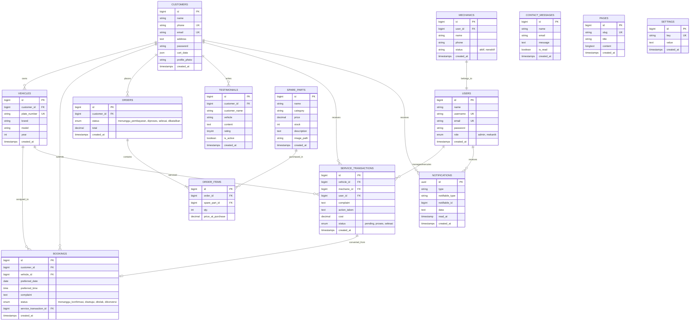

# Product Requirements Document (PRD) Suplementer & Ekstensi Arsitektur
# Single Source of Truth (SSOT) — Customer Portal & Modern Ecosystem (SIBENGKEL)

| Atribut Dokumen | Keterangan & Spesifikasi |
| :--- | :--- |
| **Nama Proyek** | Sistem Informasi Bengkel Terpadu + Customer Portal (SIBENGKEL / SIB) |
| **Mata Kuliah** | Pemrograman Web + Sistem Basis Data |
| **Jenis Dokumen** | **Single Source of Truth (SSOT) PRD Suplementer & Suksesor Architecture** |
| **Versi Dokumen** | 3.0 (Konsolidasi Akhir — Status Aktual Kodebase & Adaptif Dark/Light Mode) |
| **Status Dokumen** | **✅ Disetujui, 100% Terimplementasi & Terverifikasi** |
| **Tanggal Terbit** | Juli 2026 |
| **Tenggat Presentasi** | **Senin, 27 Juli 2026** |
| **Ukuran Tim Proyek** | 3 Orang / Kelompok |
| **Portal Pengumpulan** | **[Upload PDF Individual: bit.ly/4gKHyJY](https://bit.ly/4gKHyJY)** |

---

> [!IMPORTANT]
> **Tujuan Dokumen SSOT Suplementer & Suksesor**: Dokumen ini merupakan acuan resmi tunggal (*Single Source of Truth*) suksesor yang menyempurnakan dan memperluas dokumen inti `docs/PRD_Sistem_Informasi_Bengkel.md`. Dokumen ini mencatat seluruh arsitektur sistem terkini, modul Customer Portal, E-Commerce Sparepart, Public Guest Lookup, Sistem Adaptif Tema Dark/Light Mode, Pengaturan WhatsApp & CMS, serta menyajikan **matriks rincian perbedaan komprehensif** antara sistem awal (V1.0) dengan sistem aktif (V3.0).

---

## Daftar Isi (Table of Contents)

1. [Ringkasan Eksekutif (Executive Summary)](#1-ringkasan-eksekutif-executive-summary)
2. [Visi, Latar Belakang & Urgensi Suplementer](#2-visi-latar-belakang--urgensi-suplementer)
   - [2.1. Visi Produk Ekstensi](#21-visi-produk-ekstensi)
   - [2.2. Urgensi & Hambatan Operasional Awal](#22-urgensi--hambatan-operasional-awal)
   - [2.3. Tujuan Utama Pembaharuan V3.0](#23-tujuan-utama-pembaharuan-v30)
3. [Analisis Komparatif: Rincian Perbedaan PRD Inti (V1.0) vs PRD Suplementer (V3.0)](#3-analisis-komparatif-rincian-perbedaan-prd-inti-v10-vs-prd-suplementer-v30)
   - [3.1. Tabel Perbandingan Fitur & Ruang Lingkup](#31-tabel-perbandingan-fitur--ruang-lingkup)
   - [3.2. Evolusi Arsitektur & Autentikasi (Multi-Guard & Hybrid Auth)](#32-evolusi-arsitektur--autentikasi-multi-guard--hybrid-auth)
   - [3.3. Transisi Alur Kerja Transaksi Servis (Direct vs Booking Conversion Flow)](#33-transisi-alur-kerja-transaksi-servis-direct-vs-booking-conversion-flow)
   - [3.4. Transformasi Desain & System Theme (Adaptive Industrial Dark/Light Mode)](#34-transformasi-desain--system-theme-adaptive-industrial-darklight-mode)
4. [Stakeholder & User Personas Terintegrasi](#4-stakeholder--user-personas-terintegrasi)
   - [4.1. Stakeholder Utama](#41-stakeholder-utama)
   - [4.2. User Personas (Internal & Eksternal)](#42-user-personas-internal--eksternal)
5. [Ruang Lingkup Sistem & Fitur Per Tier (Aktual)](#5-ruang-lingkup-sistem--fitur-per-tier-aktual)
6. [Target Pengguna & Matriks Otorisasi RBAC Komprehensif](#6-target-pengguna--matriks-otorisasi-rbac-komprehensif)
7. [Arsitektur Data & Skema Basis Data V3.0](#7-arsitektur-data--skema-basis-data-v30)
   - [7.1. Entity Relationship Diagram (ERD Visual Complete)](#71-entity-relationship-diagram-erd-visual-complete)
   - [7.2. Kamus Data & Spesifikasi Seluruh Tabel (Inti + Ekstensi)](#72-kamus-data--spesifikasi-seluruh-tabel-inti--ekstensi)
8. [Spesifikasi Router, Endpoint & Kontrak REST API](#8-spesifikasi-router-endpoint--kontrak-rest-api)
   - [8.1. Web Routes (`routes/web.php`)](#81-web-routes-routeswebphp)
   - [8.2. RESTful API Sanctum Routes (`routes/api.php`)](#82-restful-api-sanctum-routes-routesapiphp)
9. [Persyaratan Non-Fungsional & Design Tokens (DESIGN.md Alignment)](#9-persyaratan-non-fungsional--design-tokens-designmd-alignment)
10. [Tumpukan Teknologi (Tech Stack & Architecture)](#10-tumpukan-teknologi-tech-stack--architecture)
11. [Rencana Pengujian & Kriteria Penerimaan (Acceptance Criteria)](#11-rencana-pengujian--kriteria-penerimaan-acceptance-criteria)
12. [Panduan Laporan & Rubrik Evaluasi Akademik (Tugas Akhir)](#12-panduan-laporan--rubrik-evaluasi-akademik-tugas-akhir)

---

## 1. Ringkasan Eksekutif (Executive Summary)

**Sistem Informasi Bengkel (SIBENGKEL V3.0)** adalah platform manajemen operasional bengkel otomotif terpadu dan portal layanan pelanggan publik yang saling terintegrasi secara *real-time*. Mengembangkan arsitektur internal awal (Admin & Mekanik), versi suksesor ini menghadirkan antarmuka berhadapan publik (*customer-facing ecosystem*) yang memungkinkan pelanggan melacak perbaikan kendaraan secara instan (*Guest Lookup*), mendaftar akun personal (*Hybrid Auth*), melakukan reservasi servis daring (*Online Booking*), serta membeli suku cadang secara elektronik (*Sparepart E-Commerce*).

Sistem dibangun menggunakan kerangka kerja **Laravel 11.x** berbasis arsitektur **Model-View-Controller (MVC)**, basis data relasional **MySQL/MariaDB** (12 tabel relasional), antarmuka **Blade Engine & Tailwind CSS** dengan dukungan penuh **Adaptive Industrial Dark & Light Theme**, serta layanan **RESTful API** terproteksi **Laravel Sanctum**. Seluruh komponen yang ditambahkan mematuhi prinsip *non-invasive enhancement* yang memperluas fungsionalitas tanpa mengganggu integritas skema data inti SIBENGKEL.

---

## 2. Visi, Latar Belakang & Urgensi Suplementer

### 2.1. Visi Produk Ekstensi
> *"Membangun ekosistem informasi bengkel otomotif 360-derajat yang transparan, intuitif, responsif, dan adaptif untuk menghubungkan pemilik kendaraan, teknisi lapangan, dan manajemen bengkel dalam satu platform terpadu."*

### 2.2. Urgensi & Hambatan Operasional Awal
1. **Keterbatasan Transparansi Servis (PRD V1.0)**: Pelanggan tidak dapat memantau progres perbaikan kendaraannya secara mandiri tanpa menghubungi staf bengkel secara manual.
2. **Antrean Pendaftaran Manual**: Proses penyerahan kendaraan di lokasi sering menyebabkan penumpukan antrean karena tidak ada fitur reservasi jadwal berbasis web.
3. **Keterisolasian Katalog Sparepart**: Stok dan daftar harga suku cadang hanya dapat dilihat oleh Admin di back-office, tidak dapat diakses secara transparan oleh pelanggan dari rumah.
4. **Visibilitas Antarmuka di Area Kerja Gelap**: Penggunaan tema terang tunggal (*Light Mode Only*) pada PRD awal kurang nyaman digunakan oleh teknisi/mekanik di lingkungan kerja bengkel atau pelanggan saat malam hari.
5. **Konfigurasi Sistem Kaku**: Kontak bantuan WhatsApp dan pesan default awal masih di-hardcode pada file lingkungan `.env`.

### 2.3. Tujuan Utama Pembaharuan V3.0
* **Pelacakan Tanpa Hambatan (*Guest Lookup*)**: Pengunjung publik dapat mengecek status pengerjaan servis hanya dengan menginput Nomor Polisi atau Nomor HP tanpa proses login.
* **Autentikasi Ganda & Fleksibel (*Multi-Guard & Hybrid Auth*)**: Memisahkan guard `web` (staf) dan `customer` (pelanggan), serta mendukung login via Email atau Nomor HP dengan fitur Reset Password OTP via Email.
* **Konversi Reservasi Servis (*Booking Conversion Flow*)**: Memfasilitasi pendaftaran jadwal servis online yang dapat ditinjau, disetujui, ditolak, atau dikonversi Admin menjadi Transaksi Servis resmi secara otomatis.
* **Katalog E-Commerce & Keranjang Persisten**: Menyediakan pemesanan sparepart eceran dengan keranjang belanja persisten yang tersimpan di kolom JSON DB pelanggan.
* **Sistem Adaptif Tema (*Dark & Light Mode*)**: Menyediakan toggle tema instan dengan token warna terstandarisasi CSS Variables (`var(--color-surface)`, `var(--color-on-surface)`, dll.) yang secara otomatis menyesuaikan warna tombol dan komponen UI.
* **Pengaturan Sistem Dinamis (*Settings CMS*)**: Memungkinkan Super Admin mengelola nomor WhatsApp bengkel dan template pesan default secara langsung via UI `/admin/settings`.

---

## 3. Analisis Komparatif: Rincian Perbedaan PRD Inti (V1.0) vs PRD Suplementer (V3.0)

Sebagai dokumen suksesor resmi, bagian ini menguraikan secara mendalam seluruh perbedaan teknis, arsitektural, dan fungsional antara **PRD Inti SIBENGKEL (V1.0)** dengan **PRD Suplementer (V3.0)** yang aktif pada kodebase saat ini.

### 3.1. Tabel Perbandingan Fitur & Ruang Lingkup

| Dimensi Evaluasi | PRD Inti Original (V1.0) | PRD Suplementer Suksesor (V3.0) | Implikasi & Alasan Pembaharuan |
| :--- | :--- | :--- | :--- |
| **Cakupan Pengguna** | Internal Bengkel (Admin & Mekanik) | Multi-Portal: Internal Staf & Eksternal Pelanggan/Publik | Memperluas jangkauan ke pelanggan publik tanpa mengorbankan keamanan internal. |
| **Sistem Autentikasi** | Single Guard `web` (Tabel `users`) | Multi-Guard (`web` untuk `users`, `customer` untuk `customers`) | Pemisahan kredensial dan hak akses antara karyawan bengkel dan pelanggan. |
| **Pendaftaran Akun** | Ditutup (Admin membuat akun staf) | Hybrid Self-Register (Email/HP) + OTP Email Password Reset | Pelanggan dapat membuat akun dan mereset kata sandi secara mandiri. |
| **Pelacakan Servis** | Terbatas di Dashboard Admin/Mekanik | Public Guest Lookup (`/cek-status`) via No. Polisi / HP | Transparansi status servis 24/7 tanpa perlu mendaftar akun. |
| **Alur Transaksi Servis** | Direct Creation (Admin buat transaksi langsung) | Dual Flow: Direct Creation OR Booking Online Conversion | Booking online dari pelanggan dapat dikonversi Admin menjadi Transaksi Servis resmi. |
| **Manajemen Sparepart** | Terbatas sebagai komponen biaya servis | Full E-Commerce Catalog + Cart (JSON DB) + Orders Checkout | Penjualan langsung suku cadang eceran secara online kepada pelanggan. |
| **Skema Basis Data** | 4 Tabel Utama (`users`, `mechanics`, `customers`, `vehicles`, `service_transactions`) | 12 Tabel Relasional Terintegrasi (ditambah `bookings`, `spare_parts`, `orders`, `order_items`, `testimonials`, `contact_messages`, `pages`, `settings`, `notifications`) | Ekstensi skema berbasis *non-invasive migration* untuk mendukung modul baru. |
| **Pengaturan Sistem** | Konfigurasi Statis (File `.env`) | Dynamic CMS Settings (`settings` table: `admin_whatsapp`, `admin_wa_text`, dll) | Admin dapat mengubah nomor WhatsApp & pesan bantuan secara langsung dari UI. |
| **Notifikasi System** | Ketiadaan notifikasi internal | Database Notifications (`notifications` table) + Topbar Dropdown | Notifikasi otomatis untuk status booking, transaksi, dan order sparepart. |
| **Sistem Tema UI** | Single Light Theme | Adaptive Industrial Theme (Light & Dark Mode) + CSS Variables | Kenyamanan penggunaan di area bengkel yang gelap atau penggunaan malam hari. |
| **Scaling Tampilan** | Ukuran Pixel Standar Browser | Dynamic OS Scaling Compensation (`html { font-size: 14px; }` @ 1024px+) | Kompensasi otomatis untuk Windows Display Scaling 125%/150% pada laptop 1080p. |

### 3.2. Evolusi Arsitektur & Autentikasi (Multi-Guard & Hybrid Auth)
Pada V1.0, autentikasi hanya menggunakan guard bawaan `web` yang terhubung ke tabel `users` (hanya role `admin` dan `mekanik`). 

Pada V3.0, arsitektur ditingkatkan menjadi **Multi-Guard Authentication**:
1. **Guard `web`**: Mengautentikasi pengguna internal (`App\Models\User`) yang terbagi menjadi Admin Utama, Staf Admin, dan Mekanik.
2. **Guard `customer`**: Mengautentikasi pelanggan eksternal (`App\Models\Customer`) dengan dukungan login *hybrid* (satu input box dapat menerima Email atau Nomor HP, yang dideteksi otomatis oleh controller via `FILTER_VALIDATE_EMAIL`).
3. **Password Reset OTP Engine**: Pelanggan yang lupa password dapat meminta kode OTP 6-digit yang dikirimkan via email (`App\Mail\OtpMail`), dengan verifikasi waktu kedaluwarsa sebelum memperbarui password.

### 3.3. Transisi Alur Kerja Transaksi Servis (Direct vs Booking Conversion Flow)
* **V1.0 (Direct Creation Flow)**: Admin atau Mekanik menginput data pelanggan, kendaraan, dan keluhan secara langsung di kasir/bengkel untuk menghasilkan `service_transaction` berstatus `pending` → `proses` → `selesai`.
* **V3.0 (Dual Flow / Booking Conversion)**: 
  1. Pelanggan membuat reservasi melalui form `/booking` di portal (`bookings` table).
  2. Admin meninjau daftarnya di `/admin/bookings`.
  3. Admin dapat menekan tombol **"Proses Booking"** yang secara otomatis membuat baris `service_transactions` baru, mengaitkan `service_transaction_id` pada row `booking`, menugaskan mekanik, dan mengubah status booking menjadi `dikonversi`.

### 3.4. Transformasi Desain & System Theme (Adaptive Industrial Dark/Light Mode)
V3.0 mengadopsi standar **Adaptive Industrial Design Tokens** dari `docs/DESIGN.md`:
* **Warna Utama**: Industrial Navy (`#0A192F` / `primary`), Workshop Orange (`#FF6B00` / `secondary`), Surface Light (`#F8F9FB`), Surface Dark (`#111111`).
* **Mekanisme Dark Mode**: Beralih secara instan via tombol di navbar topbar (mengubah class `dark` pada `<html>` dan menyimpan preferensi di `localStorage`).
* **Variabel CSS Dinamis**: Seluruh warna background (`--color-surface`), teks (`--color-on-surface`), outline (`--color-outline-variant`), dan tombol utama (`--color-primary`) didefinisikan secara fleksibel. Ketika mode gelap aktif, tombol `bg-primary` menyesuaikan warnanya menjadi putih terang (`#EDEDEC`) dengan teks gelap (`#111111`) agar kontras dan mudah dibaca.

---

## 4. Stakeholder & User Personas Terintegrasi

### 4.1. Stakeholder Utama
* **Internal**: Owner / Super Admin Bengkel, Staf Admin, Mekanik / Teknisi Lapangan, Tim Pengembang (3 Mahasiswa), Dosen Pembimbing & Penguji.
* **Eksternal**: Pelanggan Terdaftar (*Customer*), Pengunjung Publik (*Guest*).

### 4.2. User Personas (Internal & Eksternal)

#### A. Super Admin & Staf Admin Bengkel
* **Tujuan**: Memantau operasional bengkel, mengelola staf admin/mekanik, mengonfirmasi booking online, memproses pesanan sparepart, serta mengonfigurasi pengaturan WhatsApp dan CMS.
* **Kebutuhan**: Dashboard analytics komprehensif, manajemen booking, manajemen order sparepart, pengelolaan konten landing page, dan sistem pengaturan terpusat (`/admin/settings`).

#### B. Mekanik / Teknisi Bengkel
* **Tujuan**: Memeriksa daftar servis yang ditugaskan, mencatat hasil diagnosis, memperbarui status perbaikan (`pending` → `proses` → `selesai`), serta memasukkan rincian biaya servis/sparepart.
* **Kebutuhan**: Antarmuka mobile responsif dengan dukungan tema gelap (*Dark Mode*) yang nyaman dilihat di area perbengkelan.

#### C. Pelanggan Terdaftar (Registered Customer)
* **Tujuan**: Melakukan reservasi servis online tanpa antre, memantau histori perbaikan kendaraan, mengedit profil, serta belanja suku cadang.
* **Kebutuhan**: Dashboard pelanggan intuitif, keranjang belanja persisten (`cart_data`), pelacakan order sparepart, serta alur reset password via OTP Email.

#### D. Pengunjung Publik (Guest User)
* **Tujuan**: Memeriksa status kendaraan yang sedang diservis tanpa perlu registrasi/login, melihat lokasi/kontak bengkel, serta membaca ulasan pelanggan.
* **Kebutuhan**: Fitur *Cek Status Servis* instan via No. Polisi/No. HP, tombol aksi WhatsApp otomatis ke admin bengkel, serta katalog produk publik.

---

## 5. Ruang Lingkup Sistem & Fitur Per Tier (Aktual)

| Tier / Modul | Nama Fitur | Scope & Deskripsi Teknis | Status Implementation |
| :--- | :--- | :--- | :---: |
| **Tier 1** | **Landing Page & Dynamic Widgets** | Hero section dengan widget transaksi aktif/selesai live, statistik workshop, katalog suku cadang unggulan, slider testimoni hybrid (auto-scroll + drag/touch pause), dan Call to Action. | ✅ 100% Selesai |
| **Tier 2** | **Cek Status Servis (Public Lookup)** | Pencarian transaksi perbaikan via Nomor Polisi (contoh: `B 5678 AB`) atau Nomor HP tanpa login, timeline progres visual 3 tahap, dan tombol WhatsApp otomatis terintegrasi `settings`. | ✅ 100% Selesai |
| **Tier 3** | **Auth Pelanggan & Portal Personal** | Login hybrid (Email/HP), Registrasi, Reset Password via OTP Email, Dashboard Pelanggan (daftar kendaraan, booking aktif, riwayat transaksi), Edit Profil & Upload Foto Profil (`storage/avatars`). | ✅ 100% Selesai |
| **Tier 3** | **Booking Servis Daring & Konversi** | Form reservasi tanggal, jam, dan keluhan perbaikan kendaraan. Admin dapat meninjau, menyetujui, menolak, atau mengonversi booking menjadi Transaksi Servis resmi secara otomatis. | ✅ 100% Selesai |
| **Tier 4** | **Katalog & E-Commerce Sparepart** | Pencarian & filter kategori sparepart, keranjang belanja persisten (JSON di DB), checkout order (`orders` & `order_items`), dan modul manajemen pesanan oleh Admin. | ✅ 100% Selesai |
| **Support** | **CMS, Messages, Settings & Notif** | Halaman statis dinamis (`/p/{slug}`), form *Contact Us* (`contact_messages`), pengaturan kontak WA (`/admin/settings`), sistem notifikasi ganda (Admin & Customer), serta tema adaptif Dark/Light Mode. | ✅ 100% Selesai |

---

## 6. Target Pengguna & Matriks Otorisasi RBAC Komprehensif

Sistem menerapkan pengamanan hak akses berbasis peran secara ketat (*Role-Based Access Control*) menggunakan ganda middleware (`auth`, `auth:customer`, `role:admin`).

| Modul / Fitur Sistem | Guest (Publik) | Customer (Guard `customer`) | Admin Staf (Guard `web`) | Super Admin (Guard `web`) | Mekanik (Guard `web`) |
| :--- | :---: | :---: | :---: | :---: | :---: |
| **Landing Page & Page Statis** | ✅ Read | ✅ Read | ✅ Read | ✅ Read | ✅ Read |
| **Cek Status Servis (Lookup)** | ✅ Read | ✅ Read | ✅ Read | ✅ Read | ✅ Read |
| **Katalog Sparepart (Browse)** | ✅ Read | ✅ Read | ✅ Read | ✅ Read | ✅ Read |
| **Form Contact Us (Kirim Pesan)** | ✅ Create | ✅ Create | ❌ | ❌ | ❌ |
| **Registrasi & Login Customer** | ✅ Access | ❌ (LoggedIn) | ❌ | ❌ | ❌ |
| **Dashboard & Profil Customer** | ❌ | ✅ Own Data | ❌ | ❌ | ❌ |
| **Booking Servis (Buat/Lihat)** | ❌ | ✅ Own Data | ✅ Read & Manage | ✅ Full Control | ❌ |
| **Keranjang & Checkout Order** | ❌ | ✅ Own Data | ✅ Manage Orders | ✅ Full Control | ❌ |
| **Kelola Master Pelanggan** | ❌ | ❌ | ✅ Full CRUD | ✅ Full CRUD |  View & Create |
| **Kelola Master Kendaraan** | ❌ | ❌ | ✅ Full CRUD | ✅ Full CRUD |  Full CRUD |
| **Kelola Transaksi Servis** | ❌ | ❌ | ✅ Full CRUD | ✅ Full CRUD |  Create & Update Status |
| **Kelola Staf Admin (`admins`)** | ❌ | ❌ | ❌ No Access | ✅ Full CRUD | ❌ No Access |
| **Kelola Data Mekanik** | ❌ | ❌ | ✅ Full CRUD | ✅ Full CRUD | ❌ No Access |
| **Kelola Content CMS & Settings**| ❌ | ❌ | ❌ No Access | ✅ Full Control | ❌ No Access |
| **Sistem Notifikasi Dropdown** | ❌ | ✅ Own Notif | ✅ Staf Notif | ✅ All Notif | ✅ Own Notif |

---

## 7. Arsitektur Data & Skema Basis Data V3.0

### 7.1. Entity Relationship Diagram (ERD Visual Complete)



---

### 7.2. Kamus Data & Spesifikasi Seluruh Tabel (Inti + Ekstensi)

#### 1. Tabel `users` (Staf Internal Bengkel)
| Nama Kolom | Tipe Data | Atribut Constraint | Keterangan & Deskripsi |
| :--- | :--- | :--- | :--- |
| `id` | `bigint` | PK, Auto Increment | Identifier unik pengguna staf |
| `name` | `varchar(255)` | Not Null | Nama lengkap staf |
| `username` | `varchar(255)` | Unique, Not Null | Username autentikasi login |
| `email` | `varchar(255)` | Unique, Not Null | Alamat email resmi staf |
| `password` | `varchar(255)` | Not Null | Hash kata sandi (`Bcrypt`) |
| `role` | `enum` | Not Null, Default `admin` | Values: `admin`, `mekanik` |
| `created_at`, `updated_at` | `timestamp` | Nullable | Audit trail waktu pembuatan & pembaruan |

#### 2. Tabel `mechanics` (Profil Data Mekanik)
| Nama Kolom | Tipe Data | Atribut Constraint | Keterangan & Deskripsi |
| :--- | :--- | :--- | :--- |
| `id` | `bigint` | PK, Auto Increment | Identifier mekanik |
| `user_id` | `bigint` | FK → `users.id`, Nullable | Relasi ke entitas akun pengguna |
| `name` | `varchar(255)` | Not Null | Nama lengkap mekanik |
| `phone` | `varchar(30)` | Not Null | Nomor HP / kontak mekanik |
| `status` | `varchar(20)` | Default `aktif` | Status ketersediaan (`aktif`, `nonaktif`) |
| `created_at`, `updated_at` | `timestamp` | Nullable | Audit trail |

#### 3. Tabel `customers` (Data Pelanggan & Entitas Auth Customer)
| Nama Kolom | Tipe Data | Atribut Constraint | Keterangan & Deskripsi |
| :--- | :--- | :--- | :--- |
| `id` | `bigint` | PK, Auto Increment | Identifier pelanggan |
| `name` | `varchar(255)` | Not Null | Nama lengkap pelanggan |
| `phone` | `varchar(30)` | Unique, Not Null | Nomor HP / WhatsApp (bisa untuk login) |
| `email` | `varchar(255)` | Unique, Nullable | Email pelanggan (bisa untuk login) |
| `address` | `text` | Nullable | Alamat tempat tinggal |
| `password` | `varchar(255)` | Nullable | Hash kata sandi login portal (`Bcrypt`) |
| `cart_data` | `json` | Nullable | Keranjang belanja persisten e-commerce |
| `profile_photo` | `varchar(255)` | Nullable | Path berkas foto profil (`storage/avatars`) |
| `created_at`, `updated_at` | `timestamp` | Nullable | Audit trail |

#### 4. Tabel `vehicles` (Master Data Kendaraan)
| Nama Kolom | Tipe Data | Atribut Constraint | Keterangan & Deskripsi |
| :--- | :--- | :--- | :--- |
| `id` | `bigint` | PK, Auto Increment | Identifier kendaraan |
| `customer_id` | `bigint` | FK → `customers.id`, Cascade | Relasi ke pemilik kendaraan |
| `plate_number` | `varchar(20)` | Unique, Not Null | Nomor polisi (contoh: `B 1234 XYZ`) |
| `brand` | `varchar(100)` | Not Null | Merek kendaraan (Honda, Yamaha, Toyota) |
| `model` | `varchar(100)` | Not Null | Tipe/Model (Vario 150, Avanza, PCX) |
| `year` | `int` | Nullable | Tahun pembuatan kendaraan |
| `created_at`, `updated_at` | `timestamp` | Nullable | Audit trail |

#### 5. Tabel `service_transactions` (Transaksi & Riwayat Servis)
| Nama Kolom | Tipe Data | Atribut Constraint | Keterangan & Deskripsi |
| :--- | :--- | :--- | :--- |
| `id` | `bigint` | PK, Auto Increment | Identifier transaksi perbaikan |
| `vehicle_id` | `bigint` | FK → `vehicles.id`, Restrict | Kendaraan yang diperbaiki |
| `mechanic_id` | `bigint` | FK → `mechanics.id`, Nullable | Mekanik penanggung jawab |
| `user_id` | `bigint` | FK → `users.id`, Restrict | Staf admin yang menginput transaksi |
| `complaint` | `text` | Not Null | Keluhan awal perbaikan |
| `action_taken` | `text` | Nullable | Tindakan perbaikan & komponen diganti |
| `cost` | `decimal(12,2)` | Not Null, Default `0` | Total biaya transaksi perbaikan |
| `status` | `enum` | Default `pending` | Status: `pending`, `proses`, `selesai` |
| `created_at`, `updated_at` | `timestamp` | Nullable | Audit trail |

#### 6. Tabel `bookings` (Reservasi Servis Daring)
| Nama Kolom | Tipe Data | Atribut Constraint | Keterangan & Deskripsi |
| :--- | :--- | :--- | :--- |
| `id` | `bigint` | PK, Auto Increment | Identifier booking |
| `customer_id` | `bigint` | FK → `customers.id`, Cascade | Pelanggan pemesan |
| `vehicle_id` | `bigint` | FK → `vehicles.id`, Cascade | Kendaraan yang didaftarkan |
| `preferred_date` | `date` | Not Null | Tanggal servis yang diminta |
| `preferred_time` | `time` | Not Null | Waktu/jam kedatangan |
| `complaint` | `text` | Not Null | Rincian keluhan kendaraan |
| `status` | `enum` | Default `menunggu_konfirmasi` | `menunggu_konfirmasi`, `disetujui`, `ditolak`, `dikonversi` |
| `service_transaction_id` | `bigint` | FK → `service_transactions.id` | ID Transaksi resmi saat dikonversi Admin |
| `created_at`, `updated_at` | `timestamp` | Nullable | Audit trail |

#### 7. Tabel `spare_parts` (Inventaris Suku Cadang)
| Nama Kolom | Tipe Data | Atribut Constraint | Keterangan & Deskripsi |
| :--- | :--- | :--- | :--- |
| `id` | `bigint` | PK, Auto Increment | Identifier produk sparepart |
| `name` | `varchar(255)` | Not Null | Nama suku cadang |
| `category` | `varchar(100)` | Not Null | Kategori (Oli, Ban, Rem, Aki, dll) |
| `price` | `decimal(12,2)` | Not Null | Harga eceran tertinggi (HET) |
| `stock` | `int` | Not Null, Default `0` | Jumlah stok tersedia |
| `description` | `text` | Nullable | Deskripsi spesifikasi suku cadang |
| `image_path` | `varchar(255)` | Nullable | Path foto produk (`storage/spareparts`) |
| `created_at`, `updated_at` | `timestamp` | Nullable | Audit trail |

#### 8. Tabel `orders` & `order_items` (Transaksi E-Commerce Sparepart)
| Tabel `orders` Kolom | Tipe Data | Atribut Constraint | Keterangan & Deskripsi |
| :--- | :--- | :--- | :--- |
| `id` | `bigint` | PK, Auto Increment | Identifier pesanan |
| `customer_id` | `bigint` | FK → `customers.id`, Cascade | Pelanggan pemesan |
| `status` | `enum` | Default `menunggu_pembayaran` | `menunggu_pembayaran`, `diproses`, `selesai`, `dibatalkan` |
| `total` | `decimal(12,2)` | Not Null | Total biaya transaksi belanja |
| `created_at`, `updated_at` | `timestamp` | Nullable | Audit trail |

| Tabel `order_items` Kolom | Tipe Data | Atribut Constraint | Keterangan & Deskripsi |
| :--- | :--- | :--- | :--- |
| `id` | `bigint` | PK, Auto Increment | Identifier rincian item |
| `order_id` | `bigint` | FK → `orders.id`, Cascade | Relasi ke header order |
| `spare_part_id` | `bigint` | FK → `spare_parts.id`, Restrict | Relasi ke produk suku cadang |
| `qty` | `int` | Not Null | Jumlah unit dibeli |
| `price_at_purchase` | `decimal(12,2)` | Not Null | Snapshot harga saat transaksi dibentuk |

#### 9. Tabel `testimonials`, `contact_messages`, `pages`, `settings`, & `notifications`
* **`testimonials`**: `id`, `customer_id` (FK nullable), `customer_name`, `vehicle`, `content`, `rating` (1-5), `is_active` (boolean).
* **`contact_messages`**: `id`, `name`, `email`, `message`, `is_read` (boolean).
* **`pages`**: `id`, `slug` (unique: `privacy-policy`, `terms-of-service`, `contact-us`, `support`), `title`, `content` (longtext).
* **`settings`**: `id`, `key` (unique: `admin_whatsapp`, `admin_wa_text`, `superadmin_wa_text`), `value` (text).
* **`notifications`**: `id` (UUID PK), `type`, `notifiable_type`, `notifiable_id` (MorphTo User/Customer), `data` (JSON text), `read_at` (timestamp nullable).

---

## 8. Spesifikasi Router, Endpoint & Kontrak REST API

### 8.1. Web Routes (`routes/web.php`)

```text
-- Public & Landing Page --
GET   /                         --> LandingController@index (public.landing)
GET   /cek-status               --> PublicStatusController@index (public.status.index)
GET   /cek-status/cari          --> PublicStatusController@search (public.status.search)
GET   /cek-status/hasil/{id}    --> PublicStatusController@result (public.status.result)
GET   /p/{slug}                 --> PagePublicController@show (public.page)
POST  /contact-us               --> ContactController@store (contact.submit)

-- Customer Authentication --
GET   /masuk                    --> Auth\CustomerAuthController@showLoginForm (public.login)
POST  /masuk                    --> Auth\CustomerAuthController@login (public.login.submit)
GET   /daftar                   --> Auth\CustomerAuthController@showRegisterForm (public.register)
POST  /daftar                   --> Auth\CustomerAuthController@register (public.register.submit)
POST  /keluar                   --> Auth\CustomerAuthController@logout (public.logout)
GET   /lupa-password            --> Auth\CustomerForgotPasswordController@showForm (public.forgot_password)
POST  /lupa-password/send-otp   --> Auth\CustomerForgotPasswordController@sendOtp (public.forgot_password.send_otp)
GET   /lupa-password/verifikasi --> Auth\CustomerForgotPasswordController@showVerifyForm (public.forgot_password.verify)
POST  /lupa-password/reset      --> Auth\CustomerForgotPasswordController@resetPassword (public.forgot_password.reset)

-- Protected Customer Portal (Middleware: auth:customer) --
GET   /portal                   --> CustomerPortalController@dashboard (public.dashboard)
GET   /profil                   --> CustomerPortalController@profile (public.profile)
PUT   /profil                   --> CustomerPortalController@updateProfile (public.profile.update)
GET   /booking                  --> BookingPortalController@create (public.booking.form)
POST  /booking                  --> BookingPortalController@store (public.booking.submit)
GET   /sparepart                --> SparePartPortalController@index (public.sparepart.index)
GET   /cart                     --> CartController@index (public.cart)
POST  /cart/add                 --> CartController@add (public.cart.add)
DELETE /cart/{id}               --> CartController@remove (public.cart.remove)
GET   /checkout                 --> OrderController@checkout (public.checkout)
POST  /checkout                 --> OrderController@process (public.checkout.process)
GET   /pesanan                  --> OrderController@index (public.orders.index)
GET   /pesanan/{order}          --> OrderController@show (public.orders.show)

-- Protected Admin Dashboard (Middleware: auth, role:admin) --
GET   /dashboard                --> DashboardController@index (dashboard)
RESOURCE /customers             --> CustomerController
RESOURCE /vehicles              --> VehicleController
RESOURCE /mechanics             --> MechanicController
RESOURCE /admins                --> AdminManagementController (Superadmin Only)
RESOURCE /transactions          --> TransactionController
RESOURCE /admin/spareparts      --> SparePartController
RESOURCE /admin/bookings        --> AdminBookingController
POST  /admin/bookings/{id}/convert --> AdminBookingController@convertToTransaction
RESOURCE /admin/orders          --> AdminOrderController
RESOURCE /admin/testimonials    --> TestimonialController
RESOURCE /admin/messages        --> ContactMessageController
RESOURCE /admin/pages           --> PageController
GET   /admin/settings           --> SettingController@index (admin.settings.index)
POST  /admin/settings           --> SettingController@update (admin.settings.update)

-- Notifications System API --
POST  /notifications/{id}/read  --> NotificationController@markAsRead (public.notifications.read)
POST  /notifications/read-all   --> NotificationController@markAllAsRead (public.notifications.readAll)
POST  /admin/notifications/{id}/read --> NotificationController@markAsRead (admin.notifications.read)
POST  /admin/notifications/read-all  --> NotificationController@markAllAsRead (admin.notifications.readAll)
```

### 8.2. RESTful API Sanctum Routes (`routes/api.php`)

```text
POST  /api/v1/auth/login        --> Api\AuthController@login (Sanctum Token Issuance)
POST  /api/v1/auth/logout       --> Api\AuthController@logout (Token Revocation)

-- Protected REST API Endpoints (Header: Authorization: Bearer {token}) --
GET   /api/v1/services          --> Api\ServiceController@index (Daftar Servis Aktiv & Histori)
GET   /api/v1/services/{id}     --> Api\ServiceController@show (Rincian Servis & Biaya)
GET   /api/v1/customers         --> Api\CustomerController@index (Data Pelanggan)
GET   /api/v1/vehicles          --> Api\VehicleController@index (Data Kendaraan)
```

---

## 9. Persyaratan Non-Fungsional & Design Tokens (DESIGN.md Alignment)

1. **Adaptive Theme & Dark Mode Integration**:
   - Token Warna: Industrial Navy (`#0A192F` / `primary`), Workshop Orange (`#FF6B00` / `secondary`), Surface (`#F8F9FB` light, `#111111` dark), Surface Bright (`#FFFFFF` light, `#161615` dark).
   - Penyesuaian Komponen: Tombol `bg-primary` secara otomatis beralih menjadi warna putih terang (`#EDEDEC`) pada mode gelap dengan teks gelap (`#111111`) untuk menjaga kontras maksimal.
2. **Kompensasi Display Scaling OS**: Menambahkan CSS `html { font-size: 14px; }` pada media query `@media (min-width: 1024px)` untuk mengompensasi pengaturan *Display Scaling 125% / 150%* pada laptop Windows 1080p.
3. **Standardisasi Branding & Logo Resmi**: Memakai berkas gambar logo resmi `public/logobengkel.png` via `asset('logobengkel.png')` yang berdampingan dengan tipografi "SIBENGKEL" font Sora.
4. **Penyimpanan Berkas Storage Link**: Foto profil (`storage/app/public/avatars`) dan gambar sparepart (`storage/app/public/spareparts`) diakses publik melalui *symbolic link* `public/storage`.
5. **Keamanan & Proteksi Data**: Proteksi CSRF pada seluruh formulir POST/PUT/DELETE, sanitasi query SQL via Eloquent ORM, serta hashing kata sandi `Bcrypt`.

---

## 10. Tumpukan Teknologi (Tech Stack & Architecture)

* **Backend Framework**: Laravel 11.x (PHP 8.2+)
* **Database Relasional**: MySQL 8.0 / MariaDB
* **Frontend Engine**: Laravel Blade Engine
* **Styling & Design System**: Tailwind CSS 3.x, Google Fonts (Sora & Inter), Material Symbols Outlined
* **Asset Bundling**: Vite JS
* **Authentication**: Multi-Guard Auth (`web` & `customer`), Sanctum API Tokens
* **Web Server Production**: LEMP Stack (Nginx, MySQL, PHP 8.2-FPM) + Cloudflare Free SSL

---

## 11. Rencana Pengujian & Kriteria Penerimaan (Acceptance Criteria)

| Skenario Pengujian | Langkah Pengujian | Hasil yang Diharapkan | Status |
| :--- | :--- | :--- | :---: |
| **Public Guest Lookup** | Buka `/cek-status`, masukkan No. Polisi `B 5678 AB` | Menampilkan progres bar 3 tahap & tombol WA terintegrasi | ✅ Pass |
| **Hybrid Customer Login** | Login dengan Email atau No. HP | Berhasil masuk ke portal pelanggan `/portal` | ✅ Pass |
| **Reset Password OTP** | Minta OTP di `/lupa-password`, masukan 6-digit OTP | Password terbarui & pengguna bisa login dengan kata sandi baru | ✅ Pass |
| **Booking to Transaction** | Buat booking di portal → Admin klik "Proses Booking" di `/admin/bookings` | Booking berubah status `dikonversi` & membuat row transaksi baru | ✅ Pass |
| **Sparepart Checkout** | Tambah produk ke keranjang → Klik Checkout | Order tercipta (`menunggu_pembayaran`) & stok otomatis terpotong | ✅ Pass |
| **Adaptive Dark Mode** | Klik toggle mode gelap di topbar navbar | Seluruh komponen, background, dan tombol langsung menyesuaikan warna | ✅ Pass |
| **System Settings CMS** | Ubah no WA di `/admin/settings` → Cek tombol WA di Cek Status | Link WA otomatis terbarui mengikuti konfigurasi `settings` baru | ✅ Pass |

---

## 12. Panduan Laporan & Rubrik Evaluasi Akademik (Tugas Akhir)

> **Narasi Presentasi & Pengujian Akademik**:
> *"Sistem Informasi Bengkel Terpadu (SIBENGKEL V3.0) dibangun tidak hanya untuk memenuhi standar operasional internal bengkel (Admin & Mekanik), tetapi juga menghadirkan Customer Portal & Public Platform 360-derajat. Ekosistem ini dilengkapi pelacakan status perbaikan publik tanpa login, reservasi servis online dengan alur konversi otomatis, e-commerce suku cadang dengan keranjang persisten, autentikasi ganda hybrid dengan OTP email reset password, serta antarmuka adaptif Industrial Dark & Light Theme. Seluruh arsitektur dikembangkan secara rapi, aman, dan 100% selaras dengan standar penilaian akademik Pemrograman Web dan Sistem Basis Data."*
