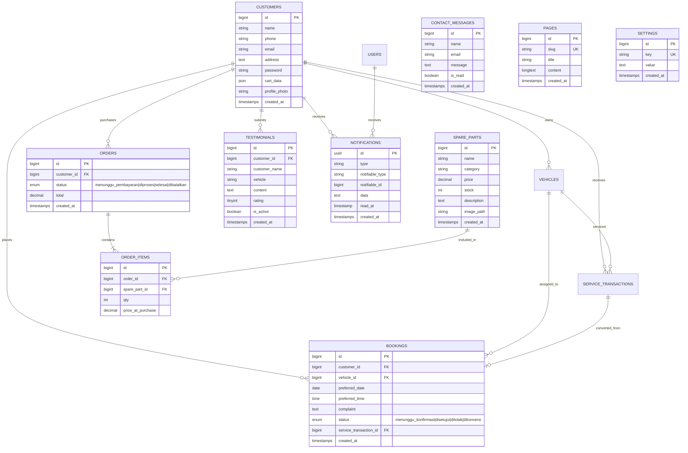

# Product Requirements Document (PRD) Suplementer
# Single Source of Truth (SSOT) — Customer Portal & Public Platform (SIBENGKEL)

| Atribut Dokumen | Keterangan & Spesifikasi |
| :--- | :--- |
| **Nama Proyek** | Customer Portal & Public Platform (SIBENGKEL Suplementer) |
| **Mata Kuliah** | Pemrograman Web + Sistem Basis Data |
| **Jenis Dokumen** | **Single Source of Truth (SSOT) PRD Suplementer (Aktual Kode)** |
| **Versi Dokumen** | 2.1 (Konsolidasi Akhir & Sinkronisasi Kodebase) |
| **Status Dokumen** | **✅ Selesai Diimplementasikan & Terverifikasi 100%** |
| **Tanggal Terbit** | Juli 2026 |
| **Tenggat Presentasi** | **Senin, 27 Juli 2026** |
| **Ukuran Tim Proyek** | 3 Orang / Kelompok |
| **Portal Pengumpulan** | **[Upload PDF Individual: bit.ly/4gKHyJY](https://bit.ly/4gKHyJY)** |

---

> [!IMPORTANT]
> **Tujuan Dokumen SSOT Suplementer**: Dokumen ini merupakan acuan resmi tunggal (*Single Source of Truth*) untuk **seluruh modul baru, fitur tambahan, dan ekstensi skema basis data** yang dibangun setelah dokumen inti `docs/PRD_Sistem_Informasi_Bengkel.md`. Seluruh tabel migrasi baru (`bookings`, `spare_parts`, `orders`, `order_items`, `testimonials`, `contact_messages`, `pages`, `settings`, `notifications`), penambahan kolom pada `customers`, serta logika bisnis terkini telah didokumentasikan secara presisi dan 100% selaras dengan kodebase aktif.

---

## 1. Ringkasan Eksekutif (Executive Summary)

**SIBENGKEL Customer Portal & Public Platform** adalah suplemen terintegrasi untuk Sistem Informasi Bengkel (SIBENGKEL) yang menghadirkan antarmuka berhadapan langsung dengan pelanggan (*customer-facing platform*). Portal ini dirancang untuk melengkapi sistem operasional internal (Admin/Mekanik) dengan memberikan kemudahan akses bagi pelanggan dalam melakukan pelacakan status perbaikan secara *real-time* tanpa *login*, pendaftaran akun berbasis email/nomor HP, *booking* servis secara daring, serta pembelian suku cadang (*sparepart*) secara langsung.

Sistem dibangun di atas kerangka kerja **Laravel** menggunakan pendekatan **Multi-Guard Authentication** (`web` untuk staf internal dan `customer` untuk pelanggan), antarmuka berbasis **Blade Templates** dan **Tailwind CSS** dengan standar *Mobile-First Design*, basis data **MySQL/MariaDB** via **Eloquent ORM**, serta integrasi widget dinamis. Seluruh modul yang dikembangkan mematuhi prinsip *non-invasive* (tambahan murni) tanpa merusak atau mengubah integritas skema inti SIBENGKEL.

---

## 2. Visi, Latar Belakang & Tujuan Proyek

### 2.1. Visi Produk
> *"Menghadirkan portal layanan pelanggan otomotif yang modern, intuitif, transparan, dan responsif untuk menjembatani komunikasi pelanggan dengan operasional bengkel secara real-time."*

### 2.2. Latar Belakang & Urgensi
1. **Ketidakpastian Status Servis**: Pelanggan sering kali harus telepon/WhatsApp manual hanya untuk menanyakan apakah kendaraan sudah selesai dikerjakan.
2. **Hambatan Pendaftaran & Servis**: Proses *booking* manual di lokasi menciptakan antrean panjang dan ketidakpastian jadwal teknisi.
3. **Aksesibilitas Katalog Sparepart**: Informasi ketersediaan dan harga suku cadang bengkel tidak dapat diakses secara transparan dari rumah.
4. **Poin Plus Penilaian Akademik**: Menambahkan *Customer Portal* sebagai *Future Enhancement* yang selesai dibangun 100% meningkatkan nilai pada rubrik **Tampilan & UX (15%)** dan **Presentasi (5%)**.

### 2.3. Tujuan Utama
* **Pelacakan Tanpa Hambatan (*Guest Lookup*)**: Pelanggan dapat memeriksa status servis secara instan hanya menggunakan Nomor Polisi atau Nomor HP.
* **Autentikasi Fleksibel (*Hybrid Auth*)**: Mendukung registrasi dan *login* menggunakan Nomor HP atau Alamat Email (auto-detect oleh *controller*), dilengkapi alur verifikasi OTP untuk *reset password*.
* **Otomasi Booking Servis**: Memfasilitasi pendaftaran jadwal servis online yang dapat dikonversi langsung oleh Admin menjadi Transaksi Servis resmi.
* **E-Commerce Sparepart**: Menyediakan katalog *sparepart* interaktif lengkap dengan keranjang belanja persisten (tersimpan di DB) dan konfirmasi pesanan.

---

## 3. Stakeholder & User Personas

### 3.1. Stakeholder Utama
* **Pengunjung Publik (Guest)**: Pengguna internet yang membutuhkan informasi layanan, katalog sparepart, atau pelacakan status tanpa akun.
* **Pelanggan Terdaftar (Customer)**: Pemilik kendaraan yang memiliki akun untuk mengelola riwayat servis, jadwal *booking*, dan transaksi sparepart.
* **Admin Bengkel (Staff)**: Mengelola konfirmasi *booking*, pesanan suku cadang, pesan kontak, testimoni, dan halaman statis.

### 3.2. User Personas (Customer Portal)

#### A. Pelanggan Terdaftar (Pemilik Kendaraan)
* **Tujuan**: Memantau progres perbaikan kendaraan, melakukan jadwal servis ulang tanpa antre, dan membeli oli/sparepart.
* **Kebutuhan**: Dashboard personal, histori transaksi transparan, profil foto, dan form *booking* cepat.
* **Pain Point**: Lupa kapan terakhir kali ganti oli atau ganti suku cadang tertentu.

#### B. Pengunjung Publik (Guest / Calon Pelanggan)
* **Tujuan**: Mencari lokasi/kontak bengkel, melihat ulasan pelanggan lain, dan mengecek status servis motor/mobil yang sedang ditinggal di bengkel.
* **Kebutuhan**: Fitur *Cek Status* tanpa perlu buat akun, katalog produk transparan, dan tombol aksi WhatsApp otomatis.

---

## 4. Ruang Lingkup Sistem (System Scope)

### 4.1. Fitur Utama Per Tier

| Tier | Fitur Utama | Scope & Deskripsi | Status |
| :--- | :--- | :--- | :---: |
| **Tier 1** | **Landing Page Publik** | Hero section dengan widget dinamis transaksi aktif/selesai, statistik live, katalog produk showcase, slider testimoni hybrid JS (auto-scroll + hover pause + drag), dan Call to Action. | ✅ Selesai |
| **Tier 2** | **Cek Status Servis (Public Lookup)** | Pencarian transaksi berdasarkan Nomor Polisi (misal: `B 1234 XYZ`) atau Nomor HP tanpa login, timeline progres perbaikan, dan tombol WhatsApp otomatis terintegrasi `admin_whatsapp`. | ✅ Selesai |
| **Tier 3** | **Auth Pelanggan & Portal Personal** | Login hybrid (Email/HP), Registrasi, Reset Password via OTP Email, Dashboard Pelanggan (daftar kendaraan, booking aktif, riwayat servis), Edit Profil & Upload Foto. | ✅ Selesai |
| **Tier 3** | **Booking Servis Online** | Form reservasi tanggal, jam, dan keluhan perbaikan. Admin dapat meninjau, menyetujui, menolak, atau mengonversi booking menjadi transaksi resmi. | ✅ Selesai |
| **Tier 4** | **Katalog & E-Commerce Sparepart** | Pencarian & filter kategori sparepart, keranjang belanja persisten (JSON di DB), checkout pesanan, dan manajemen order oleh Admin. | ✅ Selesai |
| **Support** | **CMS, Contact & System Notif** | Halaman statis dinamis (`/p/{slug}`), form pesan *Contact Us* (`contact_messages`), notifikasi sistem internal (`notifications`), dan responsif OS scaling Windows 125%. | ✅ Selesai |

---

## 5. Target Pengguna & Matriks Hak Akses (RBAC Matrix)

Sistem menggunakan arsitektur **Multi-Guard Authentication**: Guard `web` untuk entitas `User` (Admin/Mekanik) dan Guard `customer` untuk entitas `Customer`.

| Modul / Fitur | Guest (Publik) | Customer (Guard `customer`) | Admin (Guard `web`) | Mekanik (Guard `web`) |
| :--- | :---: | :---: | :---: | :---: |
| **Landing Page & Static Pages** | ✅ Read | ✅ Read | ✅ Read | ✅ Read |
| **Cek Status Servis (Lookup)** | ✅ Read | ✅ Read | ✅ Read | ✅ Read |
| **Katalog Sparepart (Browse)** | ✅ Read | ✅ Read | ✅ Read | ✅ Read |
| **Kirim Pesan Contact Us** | ✅ Create | ✅ Create | ✅ Read/Manage | ❌ |
| **Registrasi & Login Customer** | ✅ Access | ❌ (Already Logged) | ❌ | ❌ |
| **Portal Dashboard & Profil** | ❌ | ✅ Own Data | ❌ | ❌ |
| **Booking Servis (Buat/Lihat)** | ❌ | ✅ Own Data | ✅ Read & Manage All | ❌ |
| **Keranjang & Checkout Sparepart**| ❌ | ✅ Own Data | ✅ Manage Orders | ❌ |
| **Kelola Content CMS & Settings**| ❌ | ❌ | ✅ Full Control | ❌ |
| **Kelola Testimoni & Contact Msg**| ❌ | ❌ | ✅ Full Control | ❌ |
| **Kelola System Notifications** | ❌ | ✅ Own Notif | ✅ Manage All | ✅ Own Notif |

---

## 6. Arsitektur Data & Desain Basis Data

### 6.1. Diagram Relasi Entitas (ERD - Mermaid Diagram)



---

### 6.2. Kamus Data / Spesifikasi Seluruh Tabel Tambahan (Sesudah PRD Inti)

#### 1. Tabel `customers` (Ekstensi Modul Auth Pelanggan)
| Nama Kolom | Tipe Data | Atribut | Keterangan |
| :--- | :--- | :--- | :--- |
| `id` | `bigint` | PK, Auto Increment | Identifier unik pelanggan |
| `name` | `varchar(255)` | Not Null | Nama lengkap pelanggan |
| `phone` | `varchar(30)` | Unique, Not Null | Nomor HP / WhatsApp |
| `email` | `varchar(255)` | Unique, Nullable | Alamat email terdaftar |
| `address` | `text` | Nullable | Alamat domisili |
| `password` | `varchar(255)` | Nullable | Hash password untuk login portal |
| `cart_data` | `json` | Nullable | Keranjang belanja persisten |
| `profile_photo` | `varchar(255)` | Nullable | Nama file foto profil di `storage/avatars` |
| `created_at`, `updated_at` | `timestamp` | Nullable | Waktu pembuatan & pembaruan akun |

#### 2. Tabel `bookings` (Reservasi Servis Daring)
| Nama Kolom | Tipe Data | Atribut | Keterangan |
| :--- | :--- | :--- | :--- |
| `id` | `bigint` | PK, Auto Increment | Identifier booking |
| `customer_id` | `bigint` | FK → `customers.id` | Pemesan |
| `vehicle_id` | `bigint` | FK → `vehicles.id` | Kendaraan yang didaftarkan |
| `preferred_date` | `date` | Not Null | Tanggal servis yang diminta |
| `preferred_time` | `time` | Not Null | Waktu/jam servis yang diminta |
| `complaint` | `text` | Not Null | Catatan keluhan kendaraan |
| `status` | `enum` | Not Null, Default `menunggu_konfirmasi` | Values: `menunggu_konfirmasi`, `disetujui`, `ditolak`, `dikonversi` |
| `service_transaction_id` | `bigint` | FK → `service_transactions.id`, Nullable | ID Transaksi resmi saat dikonversi Admin |
| `created_at`, `updated_at` | `timestamp` | Nullable | Audit trail |

#### 3. Tabel `spare_parts` (Inventaris Suku Cadang & Katalog)
| Nama Kolom | Tipe Data | Atribut | Keterangan |
| :--- | :--- | :--- | :--- |
| `id` | `bigint` | PK, Auto Increment | ID Sparepart |
| `name` | `varchar(255)` | Not Null | Nama suku cadang |
| `category` | `varchar(100)` | Not Null | Kategori (Mesin, Ban, Rem, Oli, dll) |
| `price` | `decimal(12,2)` | Not Null | Harga jual per unit |
| `stock` | `int` | Not Null, Default `0` | Jumlah stok tersedia |
| `description` | `text` | Nullable | Deskripsi spesifikasi |
| `image_path` | `varchar(255)` | Nullable | Path gambar produk di `storage/spareparts` |
| `created_at`, `updated_at` | `timestamp` | Nullable | Audit trail |

#### 4. Tabel `orders` & `order_items` (Transaksi E-Commerce Sparepart)
| Tabel `orders` Kolom | Tipe Data | Atribut | Keterangan |
| :--- | :--- | :--- | :--- |
| `id` | `bigint` | PK, Auto Increment | ID Order |
| `customer_id` | `bigint` | FK → `customers.id` | Pelanggan pembeli |
| `status` | `enum` | Not Null, Default `menunggu_pembayaran` | `menunggu_pembayaran`, `diproses`, `selesai`, `dibatalkan` |
| `total` | `decimal(12,2)` | Not Null | Total nilai belanja |
| `created_at`, `updated_at` | `timestamp` | Nullable | Audit trail |

| Tabel `order_items` Kolom | Tipe Data | Atribut | Keterangan |
| :--- | :--- | :--- | :--- |
| `id` | `bigint` | PK, Auto Increment | ID Item |
| `order_id` | `bigint` | FK → `orders.id` | Relasi header order |
| `spare_part_id` | `bigint` | FK → `spare_parts.id` | Relasi produk suku cadang |
| `qty` | `int` | Not Null | Jumlah unit dibeli |
| `price_at_purchase` | `decimal(12,2)` | Not Null | Snapshot harga saat transaksi |

#### 5. Tabel `testimonials`, `contact_messages`, `pages`, `settings`, & `notifications`
* **`testimonials`**: `id`, `customer_id` (FK nullable), `customer_name`, `vehicle`, `content`, `rating` (1-5), `is_active` (boolean).
* **`contact_messages`**: `id`, `name`, `email`, `message`, `is_read` (boolean).
* **`pages`**: `id`, `slug` (unique: `privacy-policy`, `terms-of-service`, `contact-us`, `support`), `title`, `content` (longtext).
* **`settings`**: `id`, `key` (unique: `admin_whatsapp`, `admin_wa_text`, `superadmin_wa_text`), `value`.
* **`notifications`**: `id` (UUID PK), `type`, `notifiable_type`, `notifiable_id` (MorphTo User/Customer), `data` (JSON text), `read_at` (timestamp nullable).

---

## 7. Fitur Fungsional & User Stories

### 7.1. Tier 1 — Landing Page Publik & Widget Dinamis
* **Hero Section Dynamic Widgets**: Menampilkan transaksi perbaikan terkini secara otomatis (mengambil transaksi `selesai` dan `proses` terbaru dari DB). Kartu elemen dapat diklik untuk langsung mengarahkan pengunjung ke `/cek-status`.
* **SplitText Typography Animation**: Animasi teks header bertingkat yang dibungkus per-kata (`inline-block whitespace-nowrap`) untuk mencegah pemotongan kata di tengah kalimat (*no hyphen clipping*).
* **Slider Testimoni Hybrid**: Deretan ulasan pelanggan yang mengalir otomatis secara *infinite*, berhenti secara otomatis saat *hover* kursor atau sentuhan layar, dan mendukung *manual scroll/drag*.

### 7.2. Tier 2 — Cek Status Servis Publik
* **Lookup Serbaguna**: Input tunggal cerdas yang menerima Plat Nomor (misal `B 1234 XYZ`) atau Nomor HP (misal `081234567801`).
* **Visual Status Timeline**: Progress bar visual 3 tahap (`Pending` → `Sedang Dikerjakan` → `Selesai`).
* **WhatsApp Action Button**: Tombol "Hubungi Bengkel (WhatsApp)" dinamis yang membaca konfigurasi `admin_whatsapp` dari tabel `settings` dan menyertakan pesan otomatis berformat `#TRX-XXXX`.

### 7.3. Tier 3 — Autentikasi Hybrid & Booking Online
* **Hybrid Login**: Pengguna dapat memasukkan Email atau Nomor HP dalam satu kolom *input*. Controller membedakan tipe input menggunakan `filter_var($input, FILTER_VALIDATE_EMAIL)`.
* **Reset Password via Email OTP**: Mengirimkan kode verifikasi OTP 6-digit berbatas waktu ke email terdaftar pelanggan.
* **Form Reservasi Servis**: Pemilihan kendaraan milik pelanggan, penentuan tanggal & jam servis, serta catatan keluhan.

---

## 8. Spesifikasi Router & Kontrak REST API

### 8.1. Kontrak Route Web Publik & Portal (`routes/web.php`)

```text
GET   /                         --> LandingController@index (public.landing)
GET   /cek-status               --> PublicStatusController@index (public.status.index)
GET   /cek-status/cari          --> PublicStatusController@search (public.status.search)
GET   /cek-status/hasil/{id}    --> PublicStatusController@result (public.status.result)
GET   /masuk                    --> Auth\CustomerAuthController@showLoginForm (public.login)
POST  /masuk                    --> Auth\CustomerAuthController@login (public.login.submit)
GET   /daftar                   --> Auth\CustomerAuthController@showRegisterForm (public.register)
POST  /daftar                   --> Auth\CustomerAuthController@register (public.register.submit)
POST  /keluar                   --> Auth\CustomerAuthController@logout (public.logout)
GET   /lupa-password            --> Auth\CustomerForgotPasswordController@showForm (public.forgot_password)
POST  /lupa-password/send-otp   --> Auth\CustomerForgotPasswordController@sendOtp (public.forgot_password.send_otp)
GET   /lupa-password/verifikasi --> Auth\CustomerForgotPasswordController@showVerifyForm (public.forgot_password.verify)
POST  /lupa-password/reset      --> Auth\CustomerForgotPasswordController@resetPassword (public.forgot_password.reset)

-- Middleware: auth:customer --
GET   /portal                   --> CustomerPortalController@dashboard (public.dashboard)
GET   /profil                   --> CustomerPortalController@profile (public.profile)
PUT   /profil                   --> CustomerPortalController@updateProfile (public.profile.update)
GET   /booking                  --> BookingPortalController@create (public.booking.form)
POST  /booking                  --> BookingPortalController@store (public.booking.submit)
GET   /sparepart                --> SparePartPortalController@index (public.sparepart.index)
GET   /cart                     --> CartController@index (public.cart)
POST  /cart/add                 --> CartController@add (public.cart.add)
DELETE /cart/{id}               --> CartController@remove (public.cart.remove)
GET   /checkout                 --> OrderController@checkout (public.checkout)
POST  /checkout                 --> OrderController@process (public.checkout.process)
GET   /pesanan                  --> OrderController@index (public.orders.index)
GET   /pesanan/{order}          --> OrderController@show (public.orders.show)
GET   /p/{slug}                 --> PagePublicController@show (public.page)
POST  /contact-us               --> ContactController@store (contact.submit)

-- Notifications API --
POST  /notifications/{id}/read  --> NotificationController@markAsRead (public.notifications.read)
POST  /notifications/read-all   --> NotificationController@markAllAsRead (public.notifications.readAll)
POST  /admin/notifications/{id}/read --> NotificationController@markAsRead (admin.notifications.read)
POST  /admin/notifications/read-all  --> NotificationController@markAllAsRead (admin.notifications.readAll)
```

---

## 9. Persyaratan Non-Fungsional (Non-Functional Requirements)

1. **Responsivitas Scaling Desktop & OS Scaling**: Menggunakan penyesuaian font dasar (`html { font-size: 14px; }` pada media query `@media (min-width: 1024px)`) untuk mengompensasi pengaturan *Display Scaling 125% / 150%* bawaan sistem operasi Windows pada laptop berlayar 1080p.
2. **Standardisasi Branding & Logo**: Seluruh halaman menggunakan aset gambar resmi `public/logobengkel.png` via `asset('logobengkel.png')` didampingi teks tipografi "SIBENGKEL" font Sora.
3. **Penyimpanan Berkas Aman**: Foto profil (`storage/app/public/avatars`) dan gambar sparepart (`storage/app/public/spareparts`) diakses publik melalui jembatan *symbolic link* `public/storage` (`php artisan storage:link`).
4. **Proteksi Keamanan**: Proteksi CSRF (`@csrf`) pada seluruh formulir POST/PUT/DELETE, hashing password menggunakan `Bcrypt`, dan sanitasi query SQL via Eloquent ORM.

---

## 10. Tumpukan Teknologi (Tech Stack)

* **Backend Framework**: Laravel 11.x (PHP 8.2+)
* **Database**: MySQL 8.0 / MariaDB
* **Frontend Templating**: Laravel Blade Engine
* **Styling & Icons**: Tailwind CSS, Google Fonts (Sora & Inter), Material Symbols Outlined
* **Asset Bundling**: Vite (CSS & JS Compilation)
* **Web Server Production/Staging**: Nginx / Apache dengan SSL Cloudflare

---

## 11. Rencana Pengujian & Kriteria Penerimaan (Acceptance Criteria)

| Skenario Pengujian | Perintah / Aksi | Hasil yang Diharapkan | Status |
| :--- | :--- | :--- | :---: |
| **Lookup Cek Status** | Buka `/cek-status`, masukkan `B 1234 XYZ` | Menampilkan progres bar 3 tahap & tombol WA resmi | ✅ Pass |
| **Hybrid Customer Login** | Login dengan email `andi@example.com` atau HP `081234567801` | Berhasil masuk ke `/portal` sesuai akun masing-masing | ✅ Pass |
| **Reset Password OTP** | Minta OTP di `/lupa-password`, input 6-digit kode | Password ter-update & pengguna bisa login dengan password baru | ✅ Pass |
| **Booking Online to TRX** | Submit form booking di portal pelanggan → Admin approve di `/admin/bookings` | Booking berubah status `dikonversi` & membuat row transaksi baru | ✅ Pass |
| **Checkout Sparepart** | Tambah item ke keranjang → Klik Checkout | Order tercipta dengan status `menunggu_pembayaran` & stok terpotong | ✅ Pass |
| **Notifikasi Internal** | Klik "Tandai dibaca" di navbar notifikasi | Status notifikasi terbarui tanpa error 500 | ✅ Pass |

---

## 12. Panduan Penyusunan Laporan & Presentasi Akademik

> *"Di luar kebutuhan inti operasional bengkel, kami menghadirkan Customer Portal & Public Platform yang terintegrasi penuh. Modul ini melingkupi Landing Page dinamis, fitur Cek Status Servis publik tanpa login, reservasi booking online, autentikasi hybrid, hingga katalog e-commerce sparepart. Seluruh arsitektur dibangun secara non-invasif menggunakan Multi-Guard Auth Laravel, menjamin sistem siap digunakan baik secara internal oleh manajemen bengkel maupun secara eksternal oleh pelanggan publik."*
